# sextant API guide

All public symbols live in namespace `sextant`, behind one header:

```cpp
#include <sextant/sextant.h>
```

This guide covers figures, 2D plots, the window and live updates. 3D has its
own page, **[3d.md](3d.md)**; every option struct and enum is tabulated in
**[reference.md](reference.md)**; building and linking are in
**[build.md](build.md)**.

**Contents**

- [The model](#the-model)
- [2D plot types](#2d-plot-types): [line](#line) · [scatter](#scatter) ·
  [scatter_z](#scatter_z) · [bar](#bar) · [hist](#hist) · [heatmap and imshow](#heatmap-and-imshow) ·
  [fill](#fill) · [stack](#stack) · [quiver](#quiver) · [axline and axspan](#axline-and-axspan)
- [Error bars](#error-bars)
- [Contours](#contours)
- [Colormaps](#colormaps)
- [Titles, legends, colorbars and ticks](#titles-legends-colorbars-and-ticks)
- [Scales, shared and twin axes](#scales-shared-and-twin-axes): [log and symlog](#log-and-symlog-axes) ·
  [tick formats and minor ticks](#tick-formats-and-minor-ticks) · [shared axes](#shared-axes) ·
  [twin axes](#twin-axes) · [equal aspect](#equal-aspect)
- [Styling](#styling)
- [Layout](#layout): [subplots and spans](#subplots-and-spans) · [a 3D cell](#a-3d-cell-in-the-same-grid) ·
  [sizing a figure](#sizing-a-figure)
- [Saving and exporting](#saving-and-exporting)
- [The interactive window](#the-interactive-window)
- [Text and annotations](#text-and-annotations)
- [Math in text](#math-in-text)
- [Events and picking](#events-and-picking)
- [Live updates and threads](#live-updates-and-threads)
- [Reading back](#reading-back)
- [Errors](#errors)
- [Linking](#linking)

---

## The model

`Figure` is a window (or a file). Inside it is a grid of cells, each holding an
`Axes` (a 2D plot area) or an `Axes3D` (a 3D scene, see [3d.md](3d.md)). An
`Axes3D` can in turn hold `Plane2D`s: 2D plot areas placed inside the scene.

```cpp
auto fig = sextant::Figure::create({.width = 900, .height = 500});
auto ax  = fig->axes();          // the figure's single default axes
ax->line(x, y).grid();
fig->show();
```

`Figure::create()` returns a `std::shared_ptr<Figure>` and is the only way to
make one. **Keep that pointer alive for as long as you want the window open**:
destroying the `Figure` closes it.

Every `Axes` method returns `Axes&`, so calls chain:

```cpp
fig->axes()
    ->line(x, y, {.name = "signal"})
    .scatter(px, py, {.name = "samples"})
    .set_title("Run 41")
    .legend()
    .grid();
```

Note the `->` on the first call and `.` afterwards: `axes()` hands back a smart
pointer, and everything after that is a reference.

**Options are structs written with designated initializers.** You name the
fields you set, in the order they are declared, and leave the rest at their
defaults; the compiler checks the names. Every field is listed in
[reference.md](reference.md).

**Data goes in as `std::span<const double>`**, so a `std::vector`, a
`std::array`, a C array, a pointer and a length, or a contiguous container such
as Armadillo's `arma::vec` all work unchanged. **Nothing is retained by
reference**: each call copies what it needs, and your buffers are yours again
immediately.

**Colours cycle.** A series plotted without a `color` takes the axes' next colour
from matplotlib's tab10 palette (the first is `Color::Blue`), so several lines in
one axes come out distinct with no styling. `color` is a `std::optional<Color>` in
every options struct: setting one compiles as before, and reading it back from your
own options is `opts.color->r`. Colormapped plots use none. `set_color_cycle()` sets
your own palette (empty restores tab10), `cla()` restarts the cycle, and a 3D axes'
planes share its cycle.

```cpp
ax->set_color_cycle({sextant::Color::from_hex(0x264653), sextant::Color::from_hex(0xe76f51)});
```

**Objects draw in the order you plotted them**, whatever their kinds: a heatmap
plotted after a line covers it, and a `scatter_z` plotted before a `scatter` is
under it. The legend and the colorbars list series in the same order, and hover
answers for whichever is on top.

**Any object can be hidden** without removing it: `visible = false` in its options,
or later `set_<kind>_visible(i, bool)` / `<kind>_visible(i)` on `Axes`, `Plane2D` and
`Axes3D`. A hidden object is not drawn or exported, has no legend key or colorbar,
takes no hover or pick, and **leaves the automatic limits**. Its data and place stay,
and the Data panel has a Visible checkbox per object.

---

## 2D plot types

### line

```cpp
Axes& line(std::span<const double> x, std::span<const double> y, LineOptions opts = {});
Axes& line(std::span<const double> y, LineOptions opts = {});   // x = 0, 1, 2, …
```

```cpp
ax->line(t, volts, {.color = sextant::Color::Blue,
                    .linewidth = 2.0f,
                    .linestyle = sextant::LineStyle::Dashed,
                    .name = "channel A"});
```

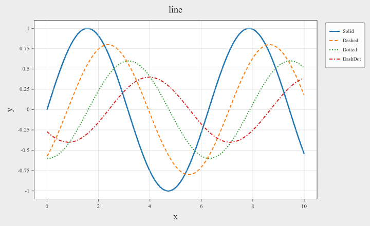

Line styles are `Solid`, `Dashed`, `Dotted`, `DashDot` and `None`. `None` draws
no stroke at all, and a series set to it drops out of the legend. Dashing is
honoured in the window, in PNG and in SVG alike.

`loop = true` adds one closing segment from the last point back to the first. It
adds no point, so limits, hover and the legend are unchanged, and a dash pattern
carries on across the seam.

`drawstyle` draws the line as steps (matplotlib's `drawstyle` and `step()`):
`DrawStyle::StepsPre`, `StepsMid` or `StepsPost` put the riser before, between or
after each point. The vertices, hover and picks are still the data's.

Lines are the type that scales: a million points pans and zooms. There is no
marker option; use `scatter()` on the same data for a marked series.

### scatter

```cpp
Axes& scatter(std::span<const double> x, std::span<const double> y,
              ScatterOptions opts = {});
```

```cpp
ax->scatter(px, py, {.color = sextant::Color::Orange,
                     .size = 24.0f,
                     .marker = sextant::MarkerStyle::Diamond,
                     .alpha = 0.6f});
```

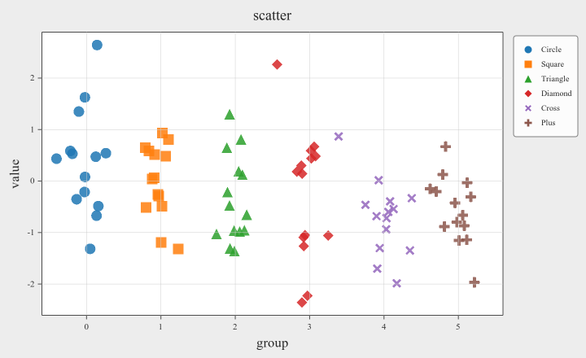

`size` is a diameter in pixels and does not change when you zoom. Sixteen
`MarkerStyle`s, as matplotlib's `o s ^ v < > D * p h X P x + | _`: `Circle`,
`Square`, `Triangle`, `TriangleDown`, `TriangleLeft`, `TriangleRight`, `Diamond`,
`Star`, `Pentagon`, `Hexagon`, `Cross`, `Plus`, the line markers `ThinCross`,
`ThinPlus`, `VLine` and `HLine` (stroked `edge_linewidth` thick), and `None`.

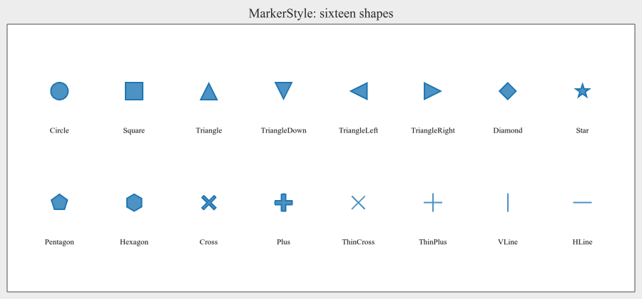

**A size per point** makes a bubble chart: `sizes` holds one diameter in pixels per
point (empty: all `size`). A NaN or non-positive size hides that point. `scatter_z`
and `scatter3d` take it too, and `ScatterData::sizes` reads and sets it.

**Outlines and hollow markers.** `edge_linewidth` (pixels, 0 by default) draws an
outline inside the marker, so `size` stays its full diameter. `edgecolor` sets its
colour (unset: the marker's own) and `edge_alpha` its opacity, independent of
`alpha`. With `alpha = 0` only the outline is drawn: a hollow marker. Every shape
takes one, `Cross` and `Plus` included. `scatter_z` and `scatter3d` have the same
fields.

```cpp
ax->scatter(px, py, {.color = sextant::Color::Orange, .size = 16.0f,
                     .alpha = 0.0f, .edge_linewidth = 2.0f});        // hollow
```

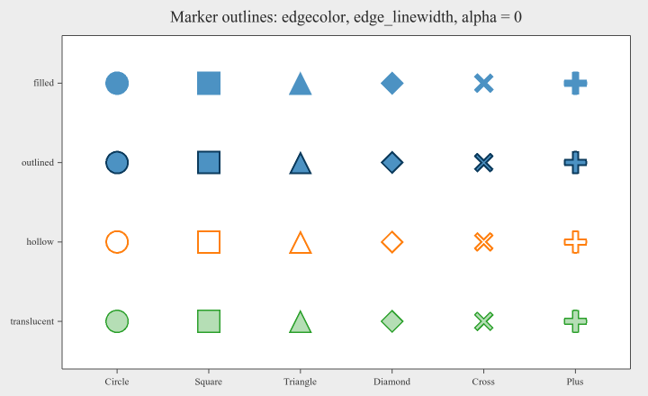

### scatter_z

A scatter whose colour carries a third value z.

```cpp
Axes& scatter_z(std::span<const double> x, std::span<const double> y,
                std::span<const double> z, ScatterZOptions opts = {});
```

```cpp
ax->scatter_z(x, y, temperature, {.vmin = -10.0f, .vmax = 40.0f,
                                  .colorbar = true, .name = "T (°C)"});
```

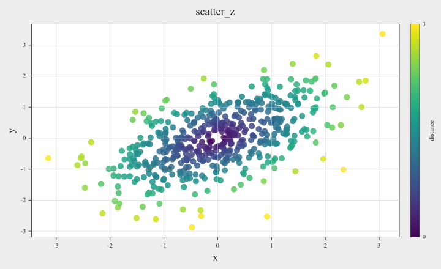

Each point's colour is `z[i]` mapped through `cmap`, `vmin` and `vmax`.
`colorbar = true` draws a bar explaining the mapping. `name` titles that bar and
also keys the series in the legend, as its marker shape filled white with a black
edge (the colour means nothing on its own).

### bar

```cpp
Axes& bar(std::span<const double> x, std::span<const double> height,
          BarOptions opts = {});
```

```cpp
ax->bar(months, balance, {.color = sextant::Color::Blue,
                          .width = 0.7f,
                          .name = "surplus",
                          .edgecolor = sextant::Color::Black});
```

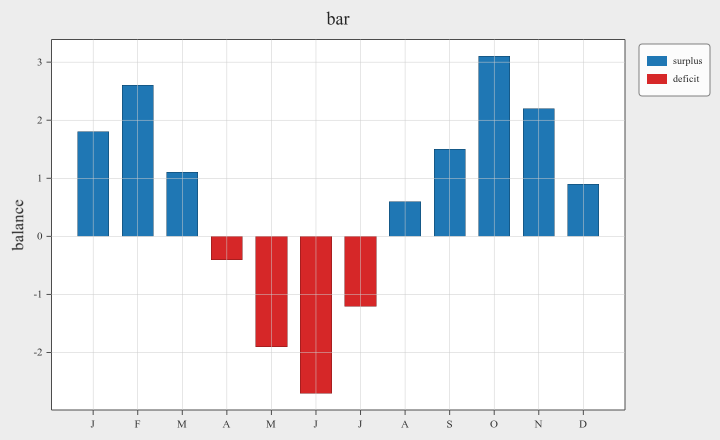

`width` is a fraction of the spacing between bars, so `1.0` makes them touch.
Negative heights draw downward from zero. Name the positions with
[`set_xticks()`](#titles-legends-colorbars-and-ticks).

**Horizontal and stacked bars.** `orientation = Orientation::Horizontal` lays the
bars along x (matplotlib's `barh`: positions on y, `height` the length), and
`bottom` sets where each bar starts, one value or one per bar. Stacking is a bar
call per layer, each with the previous tops as `bottom`; error bars hang off the
bar's end, and `BarData::bottom` reads and sets the bases.

```cpp
ax->bar(pos, a, {.color = Color::Blue, .orientation = Orientation::Horizontal, .name = "a"})
   .bar(pos, b, {.color = Color::Orange, .orientation = Orientation::Horizontal,
                 .bottom = a, .name = "b"});
```

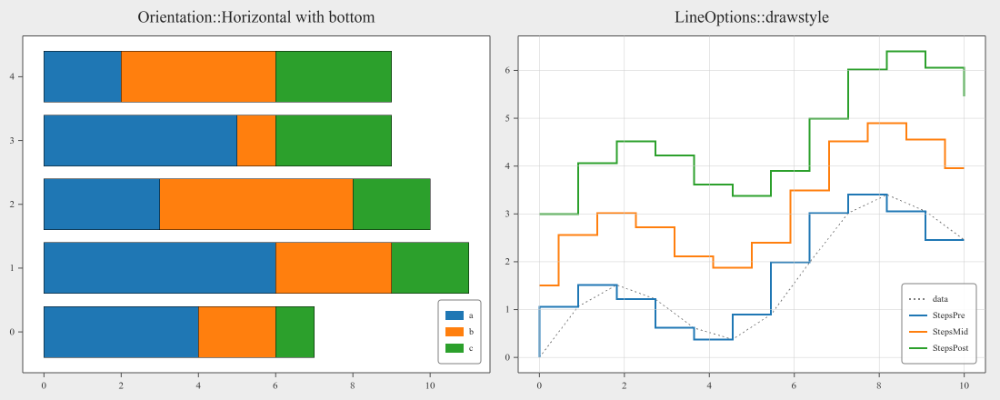

### hist

A histogram is a bar plot whose bars come from binning, so it takes both option
structs:

```cpp
Axes& hist(std::span<const double> data, int bins = 10,
           BarOptions  bar_opts  = {.width = 1.0f},
           HistOptions hist_opts = {});
```

```cpp
ax->hist(a, 40, {.color = sextant::Color::Blue, .width = 1.0f, .alpha = 0.6f,
                 .name = "A"}, {.density = true})
   .hist(b, 40, {.color = sextant::Color::Orange, .width = 1.0f, .alpha = 0.6f,
                 .name = "B"}, {.density = true});
```

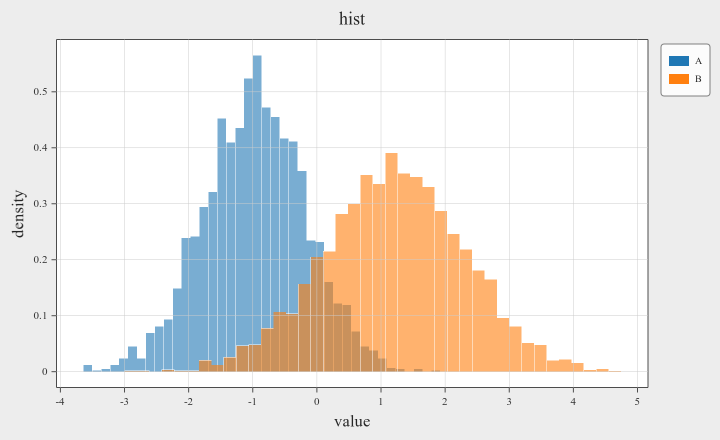

`BarOptions` says how the bars are *drawn*; `HistOptions` says what binning
means (`density`, `cumulative`). Here `width` is read against the **bin** width.

**One wart worth knowing.** `hist()`'s default argument raises `width` to `1.0`
so bins touch. If you pass your own `BarOptions` you get `BarOptions`' own
default of `0.8` back, and gapped bins read as a bar chart. Set `.width = 1.0f`
yourself whenever you pass bar options to `hist()`.

`hist()` takes no error bars: a bin height is a count sextant derived, not
something you measured. `BarOptions::orientation` and `bottom` apply to it too.

### heatmap and imshow

```cpp
Axes& heatmap(std::span<const double> data, int rows, int cols,
              Range xrange, Range yrange, HeatmapOptions opts = {});

Axes& imshow(std::span<const double> data, int rows, int cols,
             HeatmapOptions opts = {});
```

```cpp
// Where the data lives in your own coordinates: a 90x140 grid over 400..700 nm.
ax->heatmap(field, 90, 140, {400.0, 700.0}, {-1.0, 1.0},
            {.cmap = sextant::Colormap::Inferno, .vmin = 0.0f, .vmax = 1.0f,
             .colorbar = true, .name = "intensity"})
   .set_xtitle("wavelength (nm)");

// Or, when the indices *are* the coordinates:
ax->imshow(field, rows, cols, {.colorbar = true});
```

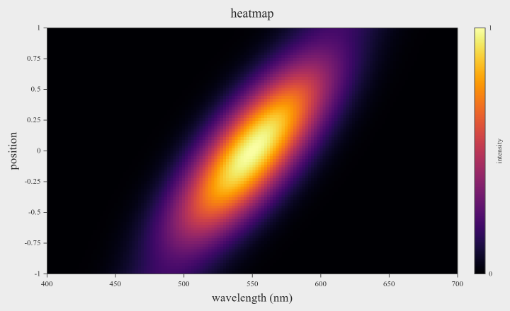

`data` is **row-major**, `rows * cols` values, indexed `row * cols + col`. Values
are stored in single precision.

`xrange` and `yrange` say where the image sits in data space. They are the
**outer edges** of the mesh, not cell centres, so a cell is `(hi - lo) / count`
across and a tick at 3 falls on the boundary between two cells. The mesh is
uniform; there is no per-cell coordinate vector. `imshow()` is the case
`{0, cols}` by `{0, rows}`: one unit per cell.

A reversed range (`lo > hi`) mirrors that axis. A degenerate (`lo == hi`) or
non-finite one throws.

Automatic limits never pad a heatmap: the image meets the frame edge, as
matplotlib's `imshow` does. Other data on the same axes is padded as usual, and
where it reaches past the image only its own side gets the room.

`origin` decides which end row 0 draws at: `"lower"` (default) puts it at the
bottom, `"upper"` at the top; any other value throws. The buffer layout does not
change either way.

Hovering a cell reports its **row and column** and value, which under a real
extent are deliberately not the numbers on the axes.

A heatmap keeps linear axes: plotting one on a log or symlog axis, or switching an
axes that holds one to such a scale, throws.

### fill

The area between two curves, as matplotlib's `fill_between`:

```cpp
Axes& fill(std::span<const double> x, std::span<const double> y1,
           std::span<const double> y2, FillOptions opts = {});
Axes& fill(std::span<const double> x, std::span<const double> y1,
           double y2 = 0.0, FillOptions opts = {});          // down to a value
```

```cpp
ax->fill(x, lo, hi, {.color = Color::Blue, .alpha = 0.3f, .interpolate = true, .name = "±σ"})
   .line(x, mean, {.color = Color::Blue});
```

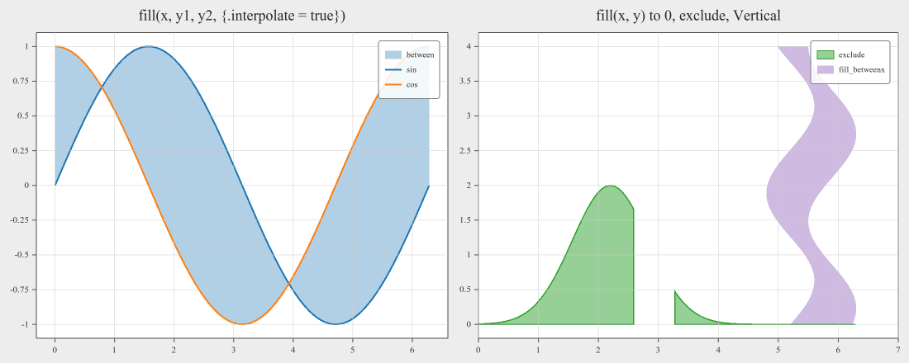

`orientation = Orientation::Vertical` fills between two x curves along y
(`fill_betweenx`; the spans then read as y, x1, x2). `exclude` is one flag per point
that leaves it out (the inverse of matplotlib's `where`), and a NaN splits the fill;
each run left is a region of its own. Where the two curves cross, `interpolate =
true` runs a region on to the crossing instead of stopping at the last point.
`drawstyle` steps the curves, and `edgecolor` with `linewidth` outlines the region.
Lengths that disagree throw `std::invalid_argument`.

Automatic limits cover every point of both curves. A fill draws in call order, has a
legend key, and is picked and hovered anywhere inside it (`PickKind::Fill`, with the
segment under the cursor in `pick_index`). `fill_data(i)` / `set_fill_data(i, …)`
read and replace it, and the Data panel edits it. `Plane2D` has `fill()` too.

### stack

Stacked areas, as matplotlib's `stackplot`: one fill per layer, each from the top of
the layers below it.

```cpp
Axes& stack(std::span<const double> x, std::span<const std::vector<double>> ys,
            StackOptions opts = {});
```

```cpp
ax->stack(t, layers, {.baseline = StackBaseline::Wiggle, .names = {"a", "b", "c", "d"}});
```

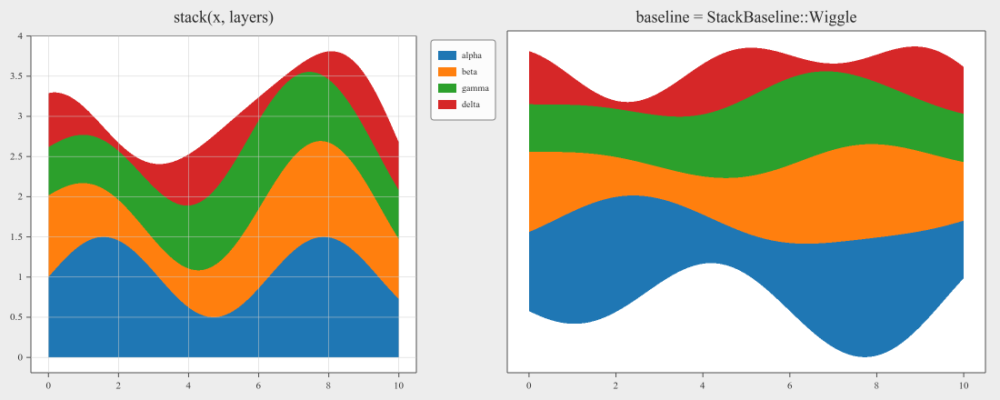

`baseline` is `Zero`, `Sym` (centred on zero), `Wiggle` or `WeightedWiggle`
(streamgraphs). `colors` and `names` take one entry per layer, and `alpha`,
`edgecolor`, `linewidth`, `linestyle` and `drawstyle` apply to all. The curves are
computed once: afterwards each layer is an ordinary fill, read back and edited as
one, and editing a layer does not restack the rest. A NaN carries up the stack.
`Plane2D` has `stack()` too.

### quiver

An arrow per point, as matplotlib's `quiver` with `angles='xy'` and
`scale_units='xy'`:

```cpp
Axes& quiver(std::span<const double> x, std::span<const double> y,
             std::span<const double> u, std::span<const double> v,
             QuiverOptions opts = {});
Axes& quiver(x, y, u, v, std::span<const double> c, QuiverOptions opts = {});   // colored
```

```cpp
ax->quiver(x, y, u, v, speed, {.cmap = Colormap::Viridis, .colorbar = true,
                               .amp = 0.18, .pivot = QuiverPivot::Middle})
   .set_aspect(1.0);
```

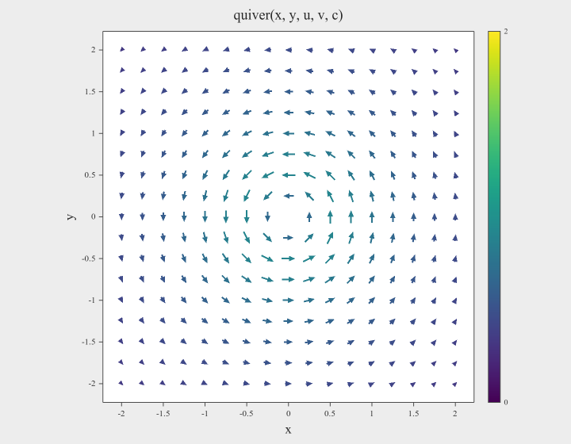

An arrow runs from `(x, y)` along `(u, v)` times `amp`, **in data units**, so it
points the way the data does only at [equal aspect](#equal-aspect). `amp` (matplotlib's
`1/scale`) is chosen from the data when unset and then kept, so the frames of an
animation stay comparable. `pivot` is `Tail`, `Middle` or `Tip`; `width`,
`head_width` and `head_length` are in pixels. With `c`, each arrow is colored through
`cmap`, `vmin` and `vmax`, with an optional colorbar; an arrow with a NaN, a zero
vector or an end at or below 0 on a log axis is not drawn. Automatic limits cover
whole arrows. Hover shows the vector (`PickKind::Quiver`), and `quiver_data(i)` /
`set_quiver_data(i, …)` read and replace it. `Plane2D` has `quiver()` too.

### axline and axspan

Reference lines and bands across the frame:

```cpp
Axes& axline(double value, AxLineOptions opts = {});
Axes& axspan(double lo, double hi, AxSpanOptions opts = {});
```

```cpp
ax->axspan(0.7, 1.3, {.color = Color::Green, .name = "±0.3"})        // axhspan
   .axline(1.0, {.linestyle = LineStyle::Dashed, .name = "mean"})     // axhline
   .axline(6.2, {.orientation = Orientation::Vertical, .name = "event"});  // axvline
```

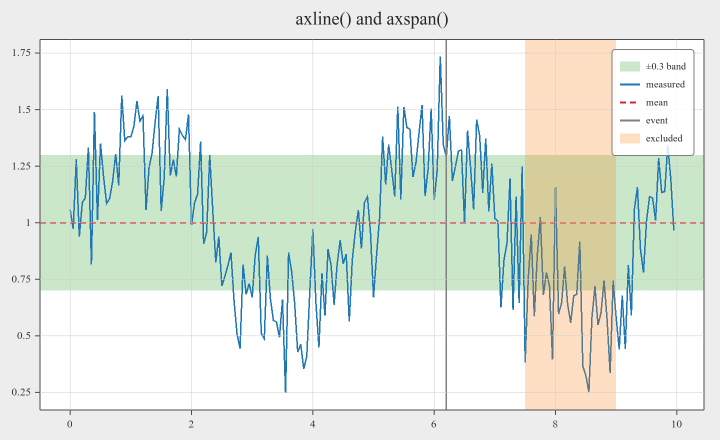

Horizontal by default (at y = value, over y); `orientation = Vertical` puts them on
x. `from` and `to` (fractions of the frame, 0..1) limit them to part of it, and a
span can be outlined with `edgecolor` and `linewidth`. They stay put through pan and
zoom along their length, draw in call order, have legend keys, and are edited in the
Data panel. Automatic limits include their values (on a log axis only those > 0);
a non-finite value throws. Read back and moved with `axline_data(i)` /
`set_axline_data(i, …)` and the `axspan_` equivalents.

---

## Error bars

An error bar decorates a series you already drew. Its **data** is an `ErrorBar`
passed just before the options; its **style** is the `errorbar` field of those
options. It is two shapes, either omittable:

- a **capped whisker**, for an observed range (`*_cap_lo`, `*_cap_hi`);
- a **box**, for a spread such as one standard deviation (`*_box_lo`, `*_box_hi`).

Every value is an **offset from the point**, not an absolute coordinate, and
magnitude-valued (a negative number is read as its size). Give one end only and
the bar is symmetric; give a zero and that side draws nothing, which is how you
make a one-sided bar. A NaN also leaves that side undrawn.

```cpp
// A whisker for the observed range and a box for one standard deviation:
ax->line(x, y, {.y_cap_lo = range_lo, .y_cap_hi = range_hi, .y_box_lo = sigma},
         {.color = sextant::Color::Blue, .name = "measured"});

// One-sided "at least this much": zeros below, arrow caps above.
ax->scatter(x, y, {.y_cap_lo = zeros, .y_cap_hi = up},
            {.errorbar = {.capstyle = sextant::CapStyle::Arrow}});

// Bars hang theirs off the tip, not the baseline:
ax->bar(centers, heights, {.y_cap_lo = err},
        {.errorbar = {.color = sextant::Color::Black, .capsize = 10.0f}});

// x and y at once; a box with both becomes a real 2D rectangle:
ax->scatter(x, y, {.x_box_lo = sx, .y_box_lo = sy});
```

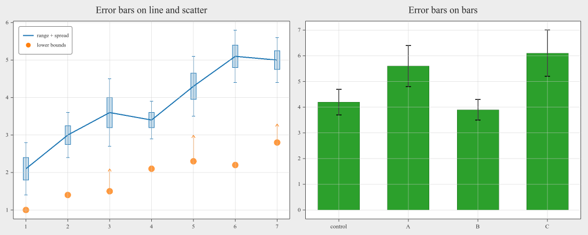

**Write the `ErrorBar` with field names.** A bare `{}` is ambiguous with the
overload that takes no error bars, and the fields are spans, so name vectors
rather than writing braced lists in place.

`line`, `scatter`, `scatter_z` and `bar` take error bars in both directions;
`hist` takes none. Every non-empty span must hold exactly one entry per point, or
the call throws. Without box data in a direction, the box is `boxwidth` pixels
across. Automatic limits widen to fit the bars, so nothing is clipped. Hovering a
point shows its offsets: `y=2.5 box ±0.3 cap +0.6/-0.5`.

The style fields (`color`, `linewidth`, `capsize`, `capstyle`, `boxwidth`,
`box_alpha`) are in [reference.md](reference.md#errorbaroptions). An unset colour
is the series' own (a bar's edge colour); for `scatter_z` it is black.

---

## Contours

A heatmap can trace iso-lines through itself.

```cpp
ax->heatmap(field, n, n, {-3.0, 3.0}, {-3.0, 3.0}, {
        .cmap = sextant::Colormap::Coolwarm, .vmin = -8.0f, .vmax = 8.0f,
        .colorbar = true,
        .contours = {-6, -4, -2, 0, 2, 4, 6},
        .contour_color = sextant::Color::from_hex(0x222222),
        .contour_labels = true});
```

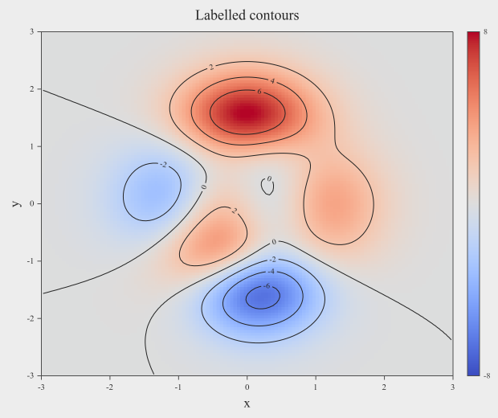

Levels are **z values in your data's own units**: the numbers the colorbar shows,
not a 0..1 scale. An empty list draws nothing and computes nothing. Levels are
sorted and de-duplicated for you; a non-finite one throws.

`contour_labels` writes each level onto its own line, rotated to follow it, with
the line broken to make room. A line too short to break keeps the line and drops
the label.

Lines pass through **cell centres**, so a contour stops half a cell inside the
image, and a heatmap smaller than 2×2 traces nothing. The traced geometry is in
data space, so it follows the extent you gave the heatmap. `origin` is honoured.

---

## Colormaps

Every colour-mapped kind takes a `Colormap`: `heatmap`, `scatter_z`, `quiver` with
a `c`, and in 3D `surface`, `surface_tri`, `scatter3d` and `line3d`.

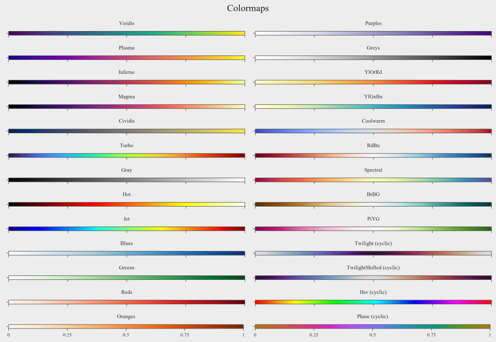

| | For |
|---|---|
| `Viridis` | The default. Perceptually uniform, readable in greyscale |
| `Plasma` | Like Viridis with more contrast |
| `Inferno`, `Magma` | Dark-to-bright; data that should glow against black |
| `Cividis` | Designed for colour-vision deficiency |
| `Turbo` | A rainbow for readers used to jet; not perceptually uniform |
| `Gray`, `Greys`, `Hot`, `Jet` | Greyscale images, and the classic heat and rainbow maps |
| `Blues`, `Greens`, `Reds`, `Oranges`, `Purples`, `YlOrRd`, `YlGnBu` | Sequential, light to dark: counts, densities |
| `Coolwarm`, `RdBu`, `Spectral`, `BrBG`, `PiYG` | Diverging: data with a meaningful centre, such as signed values |
| `Twilight`, `TwilightShifted`, `Hsv`, `Phase` | Cyclic: angles and phases, whose ends meet |

The colours match matplotlib's maps of the same names. `vmin` and `vmax` choose
the data range the map spans; values outside it take the end colours, **except with
a cyclic map, where they wrap round it**, so an angle reads right past ±π.

`Colormap` is a class, not an enum: `Colormap::Viridis` and the other names work as
before, but a `switch` over it no longer compiles. Beyond the names:

```cpp
auto r = sextant::Colormap::Viridis.reversed();                  // matplotlib's Viridis_r
auto m = sextant::Colormap::from_name("magma_r");                // any case, "_r" for reversed
auto c = sextant::register_colormap("sunset", {Color::Blue, Color::White, Color::Red});
auto h = sextant::register_colormap("clock", colors, /*cyclic=*/true);
for (const auto& name : sextant::Colormap::names()) { /* every map, registered ones included */ }
```

`register_colormap()` builds a map from two or more colours, evenly spaced, for the
rest of the process; `name()` and `is_cyclic()` read a map back. The panel's
colormap list shows registered maps, grouped as sequential, diverging and cyclic,
with a "Reversed" toggle.

---

## Titles, legends, colorbars and ticks

```cpp
ax->set_title("Run 41", 18.0f)
   .set_xtitle("time (s)")
   .set_ytitle("voltage (V)")
   .set_xlim(0.0, 10.0)
   .set_ylim(-1.0, 1.0)
   .grid()
   .legend();

fig->suptitle("Experiment 7");     // one title over the whole subplot grid
```

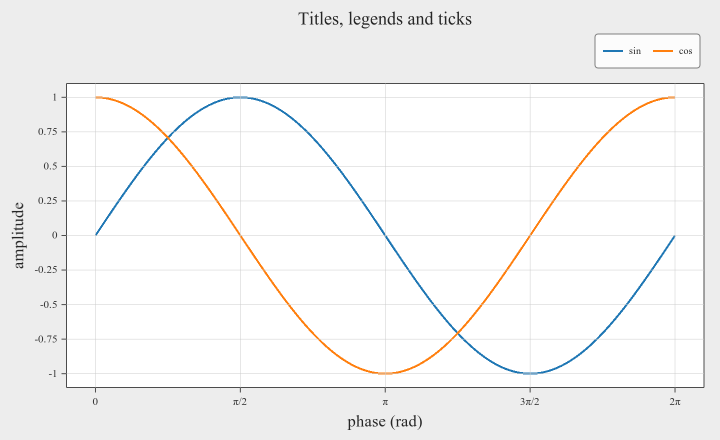

"Title" names an axis or the whole axes; "label" is the text under an individual
tick. `fontsize` is in pixels as drawn.

Limits are automatic until you set them. `set_xlim`/`set_ylim` pin them; error
bars are included when they are automatic.

**Legend.** A series appears in the legend when it has a non-empty `name` and
`show_legend` is left `true`. `legend()` places it: `LegendOptions::anchor` puts
it inside a corner of the frame (`InsideTL` … `InsideBR`, reserving no space) or
outside it (`OutsideRT` by default, and eleven others), where the plot shrinks to
make room.

```cpp
ax->legend({.anchor = sextant::LegendAnchor::InsideTL});
```

**Colorbars.** A colorbar appears because a plot object asked for one
(`colorbar = true` on a heatmap, `scatter_z` or colored `quiver`), and its `name` titles it along
the bar's outer side. Several can be asked for on one axes: each gets its own
bar, measured for its own numbers, stacked outward from the frame in plot order.
`set_colorbar_style()` styles all of an axes' bars, and chooses the side with
`ColorbarOptions::anchor` (`Left`, `Right`, `Top`, `Bottom`).

**Explicit ticks:**

```cpp
std::vector<double> days{0, 1, 2, 3, 4};
ax->set_xticks(days, {"Mon", "Tue", "Wed", "Thu", "Fri"});
ax->set_xticks(days);                // positions only, values as labels
```

The positions have to be a named array or vector, not a braced list written in
place: they arrive as `std::span<const double>`, and `std::span` gains a
constructor from `std::initializer_list` only in C++26. The labels are a
`std::vector<std::string>`, so those *can* be written inline. An empty span goes
back to automatic ticks; to hide an axis' ticks, see [Styling](#styling).

`cla()` resets the axes completely: plot objects, limits, titles, styles, legend
and ticks. To change the data of a live plot, use
[`set_*_data()`](#live-updates-and-threads) instead, which keeps everything else.

> **Ordering gotcha.** `set_title(text, size)` stores its size in the axes style,
> so a later `set_axes_style()` resets it. Call `set_axes_style()` first.

---

## Scales, shared and twin axes

### Log and symlog axes

```cpp
ax->set_xscale(sextant::Scale::Log)
   .set_yscale(sextant::Scale::Symlog, {.linthresh = 1.0})
   .grid(true, {.minor = true});
```

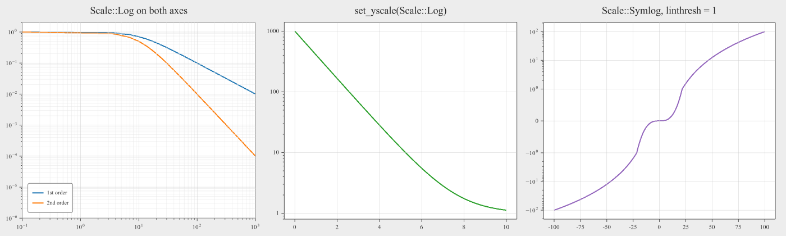

`Scale::Linear` (the default), `Log` and `Symlog`, with `ScaleOptions`: `base`
(10), and for symlog `linthresh` (the linear range around 0) and `linscale`, as
matplotlib's. `xscale()` / `yscale()` read them back. **Limits stay in data units**;
pan and zoom move whole decades.

On a log axis values <= 0 are clipped off the frame (a bar stands on its bottom
edge) and ignored by the automatic limits, and `set_xlim()` / `set_ylim()` with an
end <= 0 throw. Switching to `Log` drops set limits that reach 0 back to automatic.
Ticks fall on the decades, labelled `10^3`; symlog adds 0 and the negative decades.
A [heatmap](#heatmap-and-imshow) keeps its axes linear.

### Tick formats and minor ticks

`set_xtick_format("%.1f")` / `set_ytick_format()` take printf's format for one
number (`%f`, `%e` or `%g`, with flags, width and precision, plus any text,
[math](#math-in-text) included): `"%.0f%%"`, `"$%.1f$ ms"`. It labels the generated
ticks and any `set_xticks()` positions given without a label. Empty restores the
default; anything else (no conversion, or two) throws.

Minor ticks are unlabelled marks between the major ones, on by default for log and
symlog axes; `AxesStyle::minor_xticks` / `minor_yticks` turn them on or off, and
`minor_tick_length` sizes them. `GridOptions::minor` adds grid lines at them, in
`minor_color`.

`AxesStyle` also has per-axis variants of the tick and label fields (`xtick_color`,
`ytick_length`, `zlabel_fontsize`, …), unset by default so the shared field applies,
and `show_xtick_labels` / `show_ytick_labels` to hide an axis' labels while keeping
its marks.

### Shared axes

```cpp
top->line(x, a);
bottom->line(x, b).sharex(*top);        // also sharey()
top->set_xlim(2.0, 8.0);                // moves both
```

Axes that share an axis hold **one set of limits and one scale**: `set_xlim()`,
`set_xscale()`, pan, zoom and the panel's fields on any of them move them all, and
automatic limits cover all their data. Tick positions, formats and titles stay per
axes. Inner subplots hide their tick labels by themselves, as
`plt.subplots(sharex=True)`, and give the room back; frames along a shared axis stay
aligned, even with a legend or colorbar beside one. There is no unsharing. Sharing
an axes of another figure throws, as does putting a heatmap on a log-scaled group.

### Twin axes

```cpp
auto host = fig->axes();
host->line(t, temperature).set_ytitle("temperature [°C]");
auto twin = host->twinx();                 // shares x, its own y on the right
twin->line(t, rain).set_ytitle("rain [mm/h]");
host->set_axes_style({.yaxis_color = Color::Red});
twin->set_axes_style({.yaxis_color = Color::Blue});
```

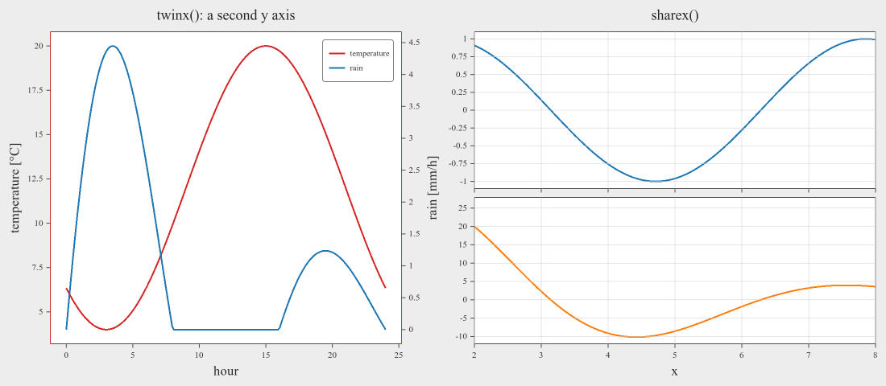

`twinx()` returns a second axes over the same frame that shares the x axis and has
its own y axis on the right; `twiny()` the same with the axes swapped. Plot into it
as into any axes; the objects of both draw in the order they were plotted, the twin
continues the host's colour cycle, and pan, zoom and reset move both.

The cell's title, legend (which lists both axes' series), colorbars and shared axis
stay the host's: on a `twinx()`, `set_title()`, `legend()`, `set_xtitle()`,
`set_xticks()` and `set_xtick_format()` act on the host. `AxesStyle::yaxis_color`
colours each y axis' frame edge, so an axis can take its series' colour. Events
report the twin's coordinate as `Event::y2data` (`x2data` for a `twiny()`), and a
pick names whose object it found in `Event::pick_twin`. In the window, a menu-bar
selector next to the subplot selector picks which layer the panels edit.

### Equal aspect

`set_aspect(ratio, adjustable)` draws one y unit `ratio` x units long, as
matplotlib's: `1.0` keeps a circle round, `0` (the default) fills the frame. Units
are the scales', so on log-log a decade is as long on both axes.

```cpp
ax->line(cx, cy, {.loop = true}).set_aspect(1.0);
```

`Adjustable::Box` (the default) shrinks the frame, centred, with its ticks, titles,
legend and colorbars; `Adjustable::Datalim` keeps the frame and widens one axis'
limits. Pan and zoom keep the ratio. `aspect()` and `adjustable()` read them back;
`cla()` resets them. A negative or non-finite ratio throws, as does `set_aspect()`
on a twin (its host's aspect sets the cell).

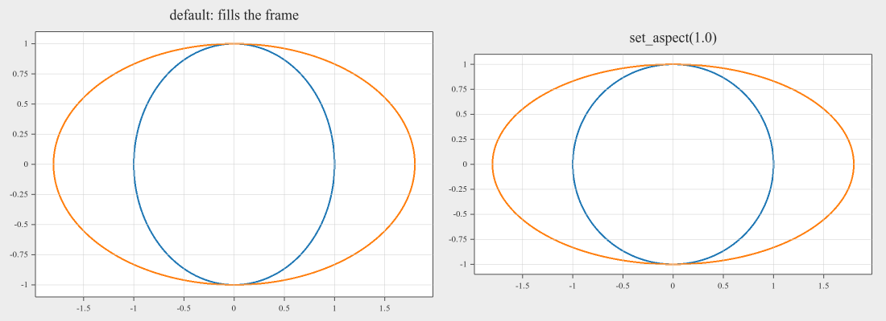

---

## Styling

Colours are plain `{r, g, b, a}` floats in 0..1, with named constants and two
parsers:

```cpp
sextant::Color::Blue;                        // also Red Green Orange Purple
                                             // Cyan Black White Gray
sextant::Color::from_hex(0x1f77b4);          // 0xRRGGBB
sextant::Color::from_hex(0x1f77b480);        // 0xRRGGBBAA
sextant::Color::from_name("orange");         // or "#1f77b4" / "#1f77b480"
sextant::Color{0.2f, 0.4f, 0.9f, 0.5f};      // half-transparent blue
```

`from_name()` takes a `#` followed by exactly 6 or 8 hex digits, or one of the
names below; anything else throws. `from_hex()` reads a value above `0xFFFFFF` as
`0xRRGGBBAA`, so an RGBA value whose red is 0 reads as RGB there; `from_name()`
has no such ambiguity.

The named colours are matplotlib's tab10 palette, so `Color::Blue` is
`rgb(31,119,180)` rather than pure blue. `Black`, `White` and `Gray` are the
plain ones.

Four structs cover the rest, each applied through its own setter:

```cpp
ax->set_axes_style({.spine_color = sextant::Color::Gray,
                    .spine_top = false, .spine_right = false,
                    .label_fontsize = 13.0f,
                    .font_path = "C:/Windows/Fonts/times.ttf"});

ax->grid(true, {.color = {0.85f, 0.85f, 0.85f, 1.0f},
                .linestyle = sextant::LineStyle::Dashed});

ax->legend({.fontsize = 12.0f, .frameon = true});

ax->set_colorbar_style({.anchor = sextant::ColorbarAnchor::Bottom});
fig->set_suptitle_style({.fontsize = 26.0f, .align = sextant::HAlign::Left});
```

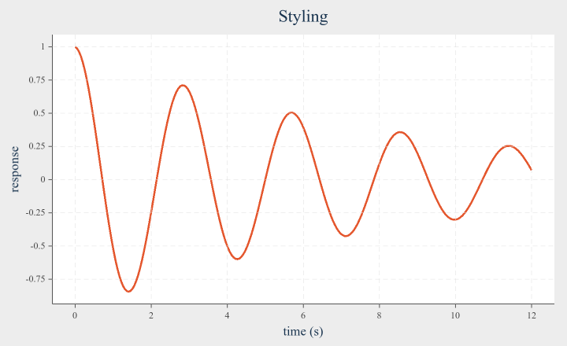

`font_path` is an absolute path to a `.ttf`/`.ttc`/`.otf`. Leave it empty for the
default, which sextant discovers from your system font directories. The legend,
colorbar and suptitle each have their own `font_path` and do **not** inherit the
axes one.

**Where the axes sit.** By default the x axis runs along the bottom of the frame
and the y axis up its left side. `AxesStyle` moves them: `xaxis_y` and `yaxis_x`
take `Low`, `Mid` or `High`, and `origin_x`/`origin_y` put them through a data
value, so `{.origin_x = 0.0, .origin_y = 0.0}` draws axes crossing at the origin,
matplotlib-style. On automatic limits, an origin outside the data widens the view
to include it. The four `spine_*` flags turn frame edges on and off
independently.

**Backgrounds.** `FigureOptions::background` (or `Figure::set_background()`) fills
behind the whole figure: margins, gaps and the suptitle, light gray by default.
`AxesStyle::background` fills a 2D plot area, white by default (a 3D box colours
its panes with `Box3DStyle::pane_color`). Alpha 0 leaves a PNG or SVG transparent
there; the window shows its panel colour instead.

**Hiding ticks.** `AxesStyle::show_xticks` and `show_yticks` (and `show_zticks` in
3D) set to `false` drop that axis' tick marks and labels and give their room back
to the plot; grid lines stay. `set_xticks({})` is different: it means automatic
ticks.

```cpp
auto fig = sextant::Figure::create({.background = sextant::Color::from_hex(0xdde6ef)});
fig->axes()->set_axes_style({.background = sextant::Color::from_hex(0x1e1f29),
                             .show_xticks = false});
```

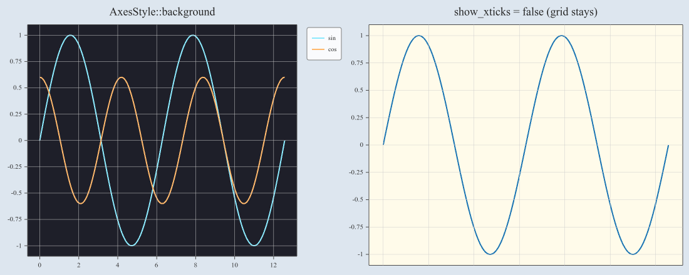

---

## Layout

### Subplots and spans

```cpp
auto fig = sextant::Figure::create({.width = 1000, .height = 620,
                                    .subplot_col_gap = 10.0f,
                                    .subplot_row_gap = 10.0f});

fig->add_subplot(2, 3, {1, 3})->line(x, y);   // the whole top row
fig->add_subplot(4)->hist(n, 30);             // the grid shape is known by now
fig->add_subplot(5)->bar(bx, bh);
fig->add_subplot(6)->heatmap(f, 40, 40, {-2, 2}, {-2, 2});
```

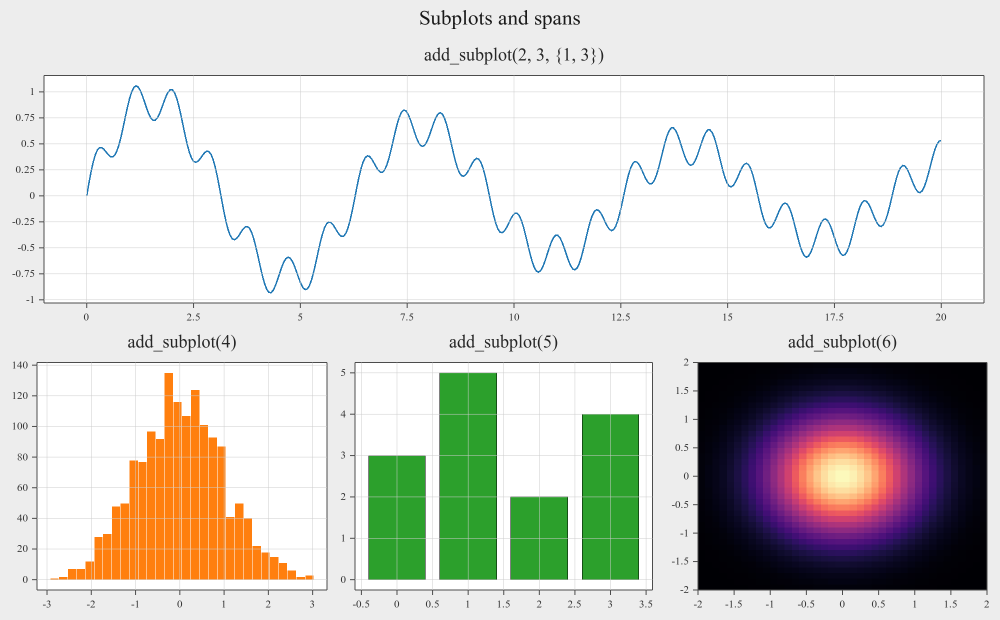

Cells are numbered `1..rows*cols`, row-major, like matplotlib. A `SubplotSpan`
`{first, last}` covers the rectangle from its top-left cell to its bottom-right
one (write it braced; a plain pair of ints would read as a grid shape).

A figure has **one grid shape**, fixed by the first call that gives one (`axes()`
counts as 1×1). After that, `add_subplot(index)` and `add_subplot({first, last})`
use it, and a different shape throws. Asking again for the same cell or span
returns what is there; any other request touching an occupied cell throws. A
span is addressed afterwards by its first cell.

The gaps separate *whole subplots*, labels and titles included. The space each
decoration needs is measured from its own text, so changing a font size moves the
text and the room made for it together; there is nothing to tune.

**Column and row weights** share out the grid unevenly:

```cpp
fig->set_col_ratios({2.0f, 1.0f, 1.0f});   // first column twice as wide
fig->set_row_ratios({1.0f, 2.0f});
```

A weight sizes the whole cell, decorations included, and a span gets the sum of
its weights. In the window, the boundary between two columns or rows can be
dragged, and a double-click evens it out.

`FigureMargins` is the border between the figure edge and the grid:

```cpp
fig->set_margins({.left = 20.0f, .right = 20.0f,
                  .top = 20.0f, .bottom = 20.0f});
```

### A 3D cell in the same grid

`add_subplot3d()` puts an `Axes3D` in a cell, under the same grid rules, so 2D
and 3D subplots sit side by side:

```cpp
fig->add_subplot(1, 2, 1)
    ->heatmap(cells, 60, 60, {-3.0, 3.0}, {-3.0, 3.0})
    .set_title("add_subplot: heatmap");

fig->add_subplot3d(1, 2, 2)
    ->surface(sextant::PlaneOrientation::XY, u, u, heights,
              {.colormap = true, .colorbar = true})
    .set_title("add_subplot3d: surface")
    .set_view(-55.0, 30.0);   // azimuth, elevation in degrees
```

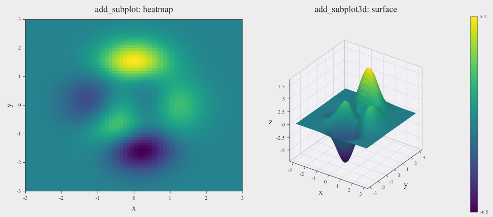

The two are siblings, not a hierarchy: an `Axes3D` is not an `Axes` and has its
own plot methods. Asking for a cell that already holds the other kind throws.
Everything about 3D is in **[3d.md](3d.md)**.

### Sizing a figure

Every size in sextant (`width`/`height`, font sizes, line widths, marker sizes,
margins) is a **logical pixel**, 1/96 inch. The window draws them at the
display's scale, so a figure looks the same on every monitor and sharper on a
high-DPI one. A PNG is written at `FigureOptions::dpi / 96` output pixels per
logical pixel: 96 (the default) gives an 800×600 file for an 800×600 figure,
192 twice that, with the same layout.

`FigureOptions::width`/`height` and `resize()` describe the **plot area**, which
is what `savefig()` writes. An open window grows by whatever its menu bar and
side panels occupy, so the plot lands on the size you asked for.

You can also work backwards from the data area you want:

```cpp
sextant::FigureSize s = fig->size_for_frame(400, 300);   // figure size for a
                                                         // 400x300 plot frame
fig->resize_to_frame(400, 300);                          // …and apply it
fig->resize_to_frame(400, 300, /*slot_index=*/2);        // of subplot 2
```

`slot_index` matters because a legend or colorbar is carved out of the cell that
owns it, so two subplots of one grid can have different frame sizes. The result
is exact apart from rounding to whole pixels.

---

## Saving and exporting

```cpp
fig->savefig("plot.png");
fig->savefig("plot.svg");
```

The format comes from the extension; anything else throws. **No window is
required for either**: both work headless, and SVG needs no OpenGL context at
all, so it runs on a server with no display. On **Linux with no display at
all** (a container, CI, an SSH session) PNG export renders through EGL, with Mesa
(software rendering included) or the GPU driver; it needs `libegl1` and Mesa at
run time and otherwise falls back to a hidden window, which needs a display.

- **PNG** is supersampled and box-filtered, and matches the figure size exactly.
  `FigureOptions::supersample` sets the factor (default 2, max 4, 1 to disable);
  cost is quadratic.
- **SVG** is vector and resolution-independent, 3D scenes included. Text names a
  font family for the viewer to resolve, matching what the window draws.

Each format has its own entry point for the options only it has:

```cpp
fig->savefig_png("plot@2x.png", {.dpi = 192});          // twice the pixels
fig->savefig_png("small.png", {}, 640, 400);            // another size
sextant::SvgSaveReport r = fig->savefig_svg("scene.svg");
```

A 3D scene whose translucent objects interpenetrate is ordered per pixel in the
PNG and per polygon in the SVG, and both have a work bound. Hitting one is not an
error: the file is written, with part of it in plain depth order, and
`SvgSaveReport` (plus a warning through the [message handler](#errors), and a
comment in the file) says so and names the number to raise. See
[3d.md](3d.md#translucency-and-depth-order).

**Export to memory.** For a web server, a GUI or a test, the same output without a
file:

```cpp
std::vector<std::uint8_t> png = fig->render_png();      // the bytes savefig_png() writes
sextant::SvgRender svg = fig->render_svg();             // svg.svg, svg.report
sextant::RgbaImage img = fig->render_rgba({.dpi = 192}); // width, height, pixels
```

They take the same options and sizes as `savefig_png()`/`savefig_svg()`, and
return exactly the bytes those write. `RgbaImage::pixels` is 8-bit RGBA, top row
first, no padding: the PNG's pixels before encoding.

A failed write (a missing directory, a full disk) throws `std::system_error`. On
Windows a file name containing `:` other than a drive letter is refused with
`EINVAL`, since NTFS would otherwise hide the image in a data stream.

Saving does not need `refresh()` for your own calls. Edits made in the window
reach a caller's `savefig()` once `refresh()` has folded them in; the window's
own **File → Save** always saves what is on screen. It takes `.png` and `.svg`
names only, and a failed save shows its reason in the window instead of ending
the program.

---

## The interactive window

`fig->show()` opens a window with a **Cosmetic** panel and a **Data** panel
docked beside the plot. It always runs on its own thread.

**Menus**

| | |
|---|---|
| **File → Save** | Write PNG or SVG at a chosen size, or at a chosen *plot-frame* size |
| **File → Resize to plot frame** | Resize the live window so a plot area hits a target |
| **File → Refit layout** | Re-measure tick labels after panning has widened them |
| **View → Cosmetic Panel / Data Panel** | Show or hide either panel |
| **Edit → Navigate** | Pan, zoom, box-zoom and orbit with the mouse |
| **Edit → Back / Forward / Home** | Step through the views: pans, zooms, boxes and 3D camera moves |
| **Edit → Hints** | Hover for values (on by default) |
| **Subplot selector** | Which subplot the panels edit (with more than one) |

**Selecting a subplot.** Click a subplot to select it (it is outlined), or pick it
in the menu bar. The panels edit the selected subplot, and navigation acts on it.

**Navigating** (Edit → Navigate). In 2D, left-drag pans, the wheel zooms at the
cursor, and Shift+drag draws a box to zoom to (a thin box zooms one axis, Esc
cancels; with an aspect ratio the box keeps the frame's shape). On a log axis pan and
zoom move whole decades. In 3D, left-drag orbits, the wheel zooms and W/A/S/D/Q/E
fly; see [3d.md](3d.md#camera).

**Back, Forward and Home** step through the views. Home is
the limits and camera *your program set* (automatic where it set none), and a
**double-click goes Home** for its subplot, so it returns to your `set_xlim()` or
`set_view()` rather than to automatic limits; a 3D axes with `set_default_camera()`
still returns to that camera.

**Hints** work over any subplot and read out the values under the cursor: `x` and
`y`, plus `z` for `scatter_z`, row, column and value for a heatmap, and the
offsets of a series with error bars. Give each point extra hover text with
`hint_labels`, index-aligned with your data:

```cpp
ax->line(x, y, {.hint_labels = {"", "", "Peak", "", "Trough"}});
```

The panels have their own guide: [panels.md](panels.md).

**Cosmetic panel.** Titles, limits, ticks and tick labels, grid, frame and axis
positions, legend, colorbars, the suptitle, margins, gaps and grid weights, and
every colour and font size, all live. Each plot object's own appearance is in its
tab of the Data panel.

**Data panel.** One tab per plot object: its appearance (colour, width, marker,
colormap and so on) and its data as an editable table, with x/y/z columns side by
side and heatmap matrices as a grid. You can retype any value, insert and delete
points, insert and delete matrix rows and columns, and choose the numeric
notation and precision. Cells are tinted by where their value falls in their
column's range; *Shade cells* turns that off. A text or annotation gets a tab too,
with its string, position, box and arrow.

The panels' look is set once at creation, and they follow the monitor's DPI:

```cpp
sextant::Figure::create({.theme = sextant::PanelTheme::Dark,   // or Light,
                         .panel_width = 300.0f});              // Classic
```

---

## Text and annotations

```cpp
Axes& text(std::string_view s, Pos x, Pos y, TextOptions opts = {});
Axes& annotate(double px, double py, std::string_view s, Pos tx, Pos ty,
               TextOptions opts = {}, ArrowOptions arrow = {});
```

`text()` writes a string over the plot; `annotate()` writes one with an arrow to
the data point `(px, py)`. Each coordinate of the text's position is a **`Pos`**:
a plain number is a data value, `Pos::fraction(f)` a fraction of the plot frame
from its left (x) or bottom (y) edge. The two are independent, so a label can
follow the data on one axis and stay put on the other:

```cpp
using sextant::Pos;
ax->text("threshold", 2.5, Pos::fraction(0.95), {.va = sextant::VAlign::Top})
   .text("n = 120", Pos::fraction(0.02), Pos::fraction(0.04))
   .annotate(t_peak, x_peak, "first peak", Pos::fraction(0.6), Pos::fraction(0.8),
             {.fontsize = 14.0f, .background = sextant::Color::White,
              .edgecolor = sextant::Color::Gray, .edge_linewidth = 1.0f},
             {.arc = 0.2f});
```

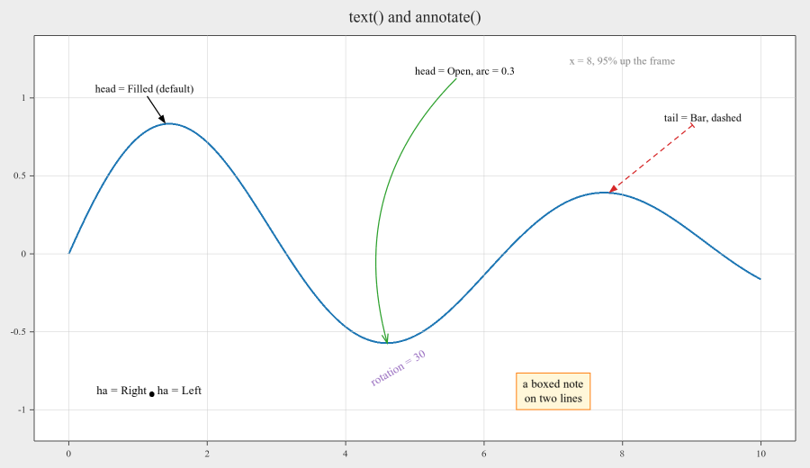

`TextOptions` sets the look: `fontsize` (pixels), `color`, `alpha`, `font_path`;
`ha`/`va`, how the block sits against its anchor (`va = Baseline` by default);
`rotation` in degrees; `dx`/`dy`, a nudge in pixels (y up); multi-line text
(`'\n'`) with `linespacing`; and a box, `background` filled and `edge_linewidth`
outlined, `pad` pixels out. `ArrowOptions` sets the arrow: `head` and `tail`
(`None`, `Open`, `Filled`, `Bar`), their size, `linewidth`, `color` (unset: the
text's), `linestyle`, the gaps left at the text and the point, and `arc`, which
bows the arrow (as matplotlib's `arc3`).

Texts are drawn over the data at a fixed pixel size: they never widen the
automatic limits and reserve no room. A text whose **data** coordinate leaves the
view is hidden whole; `clip_to_frame = true` cuts it at the frame instead. An
annotation is hidden while its point is out of view. A non-finite coordinate
throws `std::invalid_argument`.

Texts appear in the window, PNG and SVG, have a tab in the Data panel, and read
back like plot objects: `text_count()`, `text_data(i)` (a `TextData`: the string,
both coordinates and their `Coords`, the arrow and its point) and
`set_text_data(i, …)`. 3D has `text()`, `text2d()` and `annotate()` of its own;
see [3d.md](3d.md#text-and-annotations).

---

## Math in text

Every string sextant draws can hold math: titles, axis titles, the suptitle,
legend and colorbar names, custom tick labels and texts, in 2D and 3D. Write it
between dollars, as in matplotlib:

```cpp
ax->set_xtitle(R"($\theta$ [rad])")
   .set_title(R"(Damped oscillator: $x(t) = e^{-\gamma t}\sin(\omega t)$)");
```

It is a large subset of matplotlib's mathtext, laid out by sextant itself:

- superscripts and subscripts, `x^2`, `x_i`, `x_{i,j}^{2}`, nestable;
- Greek letters and about 150 symbols by name: `\alpha`, `\Delta`, `\pm`,
  `\times`, `\leq`, `\neq`, `\approx`, `\infty`, `\nabla`, `\rightarrow`, …;
- function names set upright, `\sin`, `\cos`, `\log`, `\exp`, `\max`, …;
- TeX spacing (`\,`, `\;`, `\quad`, …) and the spacing around operators;
- **fractions and roots**: `\frac{a}{b}` (also `\tfrac`, `\dfrac`), `\binom{n}{k}`,
  `\sqrt{x}`, `\sqrt[n]{x}`, `\overline{}`, `\underline{}`;
- **accents**: `\hat`, `\bar`, `\tilde`, `\dot`, `\ddot`, `\acute`, `\grave`,
  `\breve`, `\check`, `\mathring`, `\vec`, and across a whole body `\widehat`,
  `\widetilde`, `\overrightarrow`, `\overleftarrow`;
- **delimiters sized to their contents**: `\left( … \middle| … \right)` with any of
  `( ) [ ] \{ \} | \| / \backslash < >` or `.` for none, and `\big`, `\Big`,
  `\bigg`, `\Bigg` for a fixed size;
- **big operators and limits**: `\sum`, `\prod`, `\int`, `\iint`, `\oint`,
  `\bigcup`, … draw larger, with limits above and below (`\lim`, `\max`, `\sup`
  too), `\overset`, `\underset`, `\stackrel`, `\substack`, `\operatorname`;
- **fonts and alphabets**: `\mathrm{}` (upright), `\mathit{}` (italic), `\mathbf{}`
  (bold), `\mathcal{}` and `\mathscr{}`, `\mathbb{}`, `\mathfrak{}`, `\mathsf{}`,
  `\mathtt{}`, and `\text{}` (upright, spaces kept).

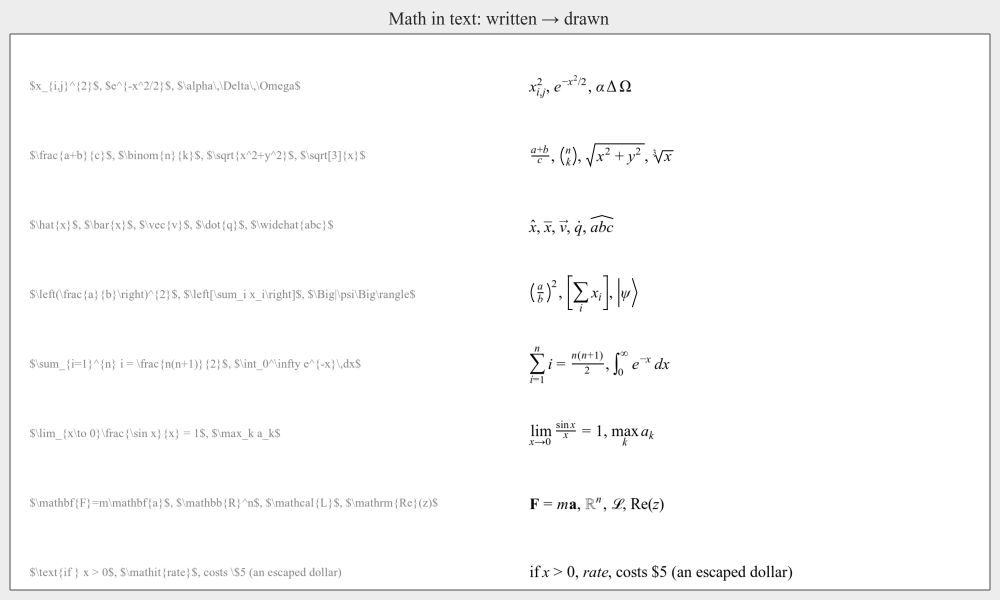

Letters draw italic, as in TeX; digits, symbols, Greek capitals and function names
stay upright. The italic is the font's own italic face, or its regular face
slanted when it has none, and bold likewise. Symbols the font lacks come from a
system symbol font (Segoe UI Symbol and Cambria Math on Windows, STIX Two Math on
macOS, DejaVu Sans on Linux). The SVG writes math as `<tspan>`s, so it stays text.

**Math fonts.** `FigureOptions::math_fontset` chooses the font math draws in, as
matplotlib's `mathtext.fontset`, from the fonts installed (none is bundled):
`MathFontset::Text` (the default) is the text's own font; `Stix` takes STIX Two
Math, STIX Two Text or STIXGeneral; `Cm` takes Latin Modern Math, CMU Serif or
Latin Modern Roman; `Custom` takes the font file at `math_font_path`. With none
installed the text font is used, and creating the figure sends one message. `\text{}`
stays in the text font. It is fixed when the figure is created.

**When a string is math.** As in matplotlib: when it has an even, nonzero number
of `$` not preceded by a backslash. `\$` is a literal dollar, and a string with
one `$` or none draws as written. Math that does not parse (an unknown command, an
unclosed brace) is drawn as written, and the call that set it sends a warning
through [`set_message_handler()`](#errors).

Turn it off for a whole figure with `FigureOptions::mathtext = false`, or for one
text with `TextOptions::parse_math = false`. Not supported: `\boldsymbol`, `\color`,
matrices and environments, and `usetex`.

---

## Events and picking

Your code can react to what the user does in the window, like matplotlib's
`mpl_connect`:

```cpp
int id = fig->connect(sextant::EventKind::MouseDown, [](const sextant::Event& e) {
    if (e.has_data) std::printf("clicked (%g, %g) in subplot %d\n", e.xdata, e.ydata, e.axes);
});
fig->connect(sextant::EventKind::Pick, [&](const sextant::Event& e) {
    if (e.pick_kind == sextant::PickKind::Line)
        std::printf("line %d, point %d\n", e.pick_object, e.pick_index);
});
fig->connect(sextant::EventKind::KeyDown, [&](const sextant::Event& e) {
    if (e.key == "escape") fig->close();
});
fig->show(false);
sextant::Figure::run();          // deliver events until every window is closed
fig->disconnect(id);
```

| `EventKind` | When | Fields |
|---|---|---|
| `MouseDown`, `MouseUp` | A button over the plot (the release also off it, if the press began on it) | `button` (0 left, 1 right, 2 middle), `double_click`, position, data, `mods` |
| `MouseMove` | The cursor moves over the plot, or during a press begun on it | position, data, `mods` |
| `Scroll` | The wheel over the plot | `scroll_x`, `scroll_y` in notches, position, data |
| `KeyDown`, `KeyUp` | A key, while no text field is being edited | `key`: `"a"`, `"A"`, `"ctrl+s"`, `"escape"`, `"f5"`, `"left"`, …; `mods` |
| `Resize` | The plot area changed size | `width`, `height` |
| `Close` | The window closed, by the user or `close()` | |
| `Pick` | A plot object was under a press, sent right after its `MouseDown` | `pick_*`, below |

The **position** `x`, `y` is in the figure's logical pixels from the top left of
the plot area; `axes` is the subplot under it (the index `add_subplot()` takes, -1
outside every frame). The **data** `xdata`, `ydata` is the point under the cursor
in that subplot's coordinates, with `has_data` true; on an axes with twins, `y2data`
is the `twinx()`'s y under the cursor and `x2data` the `twiny()`'s x (NaN without that
twin). In a 3D subplot it is where
the cursor meets the nearest visible `Plane2D` (`zdata` too); elsewhere in 3D
`has_data` is false. `consumed` says what sextant itself did with the input
(selected a subplot, navigated, dragged a grid boundary): every event is reported
either way, and a callback cannot suppress sextant's own handling.

**Picking.** A press on a plot object also sends one `Pick` event. A point, marker,
arrow or path vertex within the **pick radius** answers first, the nearest
(`FigureOptions::pick_radius`, 12 pixels by default, or `Figure::set_pick_radius()`);
otherwise the topmost bar, fill or heatmap cell the press is *inside*, whose
position is the event's `xdata` / `ydata`. `pick_kind` is `Line`, `Scatter`,
`ScatterZ`, `Bar`, `Heatmap`, `Quiver`, `Fill`; `Bar3D`, `Surface`, `SurfaceTri`,
`Scatter3D`, `Line3D`,
`pick_object` (the object's index in its kind, the `i` of `line_data(i)` and
friends), `pick_index` (the point, bar or vertex; the flat cell index of a heatmap
or `bar3d`; a fill's segment *i*, between its points *i* and *i* + 1), `pick_row`/`pick_col` for those grids, and `pick_plane`, the
`Plane2D`'s index in `Axes3D::plane_at()` for an object on a plane (-1 otherwise),
and `pick_twin` (0 the axes' own, 1 its `twinx()`, 2 its `twiny()`). Reference
lines, spans and texts are decorations and are never picked. It finds what the hover
hints find. The indices refer to the data the window drew.

**Where callbacks run.** The window never calls them. It queues events, and they
run **on your thread**, inside `wait_closed()`, `Figure::run()`,
`Figure::poll_events()` or `dispatch_events()`, in order. So a callback may block,
change the figure, or close it. A program that never calls one of those sees no
events; a loop that keeps a window up should call one of them each pass:

```cpp
while (!fig->wait_closed(1.0 / 60)) {   // delivers events while it waits
    step();
    fig->refresh();
}
```

`dispatch_events()` delivers one figure's queue and returns how many it ran, for
a loop with its own way of pumping. Callbacks for one kind run in the order
connected; an exception a callback throws goes to the message handler and does not
stop delivery; events nobody connected for are never queued. `disconnect(id)`
also drops that callback's queued events, and may be called from inside a
callback.

---

## Live updates and threads

The window renders on its own thread from a snapshot of your data. Your thread
keeps the `Figure` and its axes, changes them, and publishes with `refresh()`:

```cpp
auto fig = sextant::Figure::create();
auto ax  = fig->axes();
ax->line(x, y, {.name = "u(t)"}).set_title("Simulation");
fig->show(false);                       // returns at once

while (!fig->wait_closed(1.0 / 60)) {   // until the user closes the window
    simulate_step(y);
    ax->set_line_data(0, x, y);         // replace series 0, keep everything else
    fig->refresh();                     // publish a new snapshot
}
```

**`set_<kind>_data(i, …)` replaces object `i`'s data in place** and keeps its
options, the axes' titles, limits and styles, and anything edited in the window.
It exists for every kind (`set_line_data`, `set_scatter_data`,
`set_scatter_z_data`, `set_bar_data`, `set_heatmap_data`, `set_fill_data`,
`set_quiver_data`, `set_axline_data`, `set_axspan_data`, and the 3D ones), in two
forms: the plotting call's own arguments as spans, or the struct `<kind>_data(i)`
returns. It checks the data as the plotting call would and throws without
changing anything if it is bad. Error bars and `hint_labels` stay while the point
count is unchanged and are dropped otherwise.

**Waiting for the window.**

| | |
|---|---|
| `show(true)` (the default) | Blocks until you press ENTER at the console; the window keeps running |
| `show(false)` | Returns at once |
| `wait_closed(timeout_s)` | Returns `true` once this figure's window has closed, `false` if the timeout ran out first; negative waits forever. Any thread, any number of waiters |
| `Figure::run()` | Waits until every open figure in the process has closed |
| `Figure::poll_events()` | Pumps window events once and delivers every figure's queued events; see macOS below |
| `dispatch_events()` | Delivers this figure's queued events |

The waits deliver [events](#events-and-picking) on the waiting thread.

**The rules:**

- **One call at a time per figure.** A `Figure` with its `Axes`, `Axes3D` and
  `Plane2D`s is one object graph, which the window thread never touches (it draws a
  published copy). Any thread may call into it, window open or not, but calls must
  not overlap: serialize them yourself, as with a standard container. Separate
  figures are independent.
- **Safe from any thread at any time**, even during another call on the same
  figure: `is_open()`, `wait_closed()`, `frame_stats()`, `connect()`,
  `disconnect()`, `dispatch_events()`, `set_message_handler()`, and, where they are
  allowed, `poll_events()` and `run()`.
- **Calls that block:** `show()` until the window is up; `close()` and the
  destructor until the window's thread has joined; `savefig*()`/`render_*()` for
  the render, on the window's thread when one is open.
- `refresh()` throws `std::logic_error` before `show()` or after the window has
  closed.
- **Edits made in the window survive `refresh()`**: typed titles, a panned view,
  retyped data, styles, all of it. When both you and the user change the same
  thing, the later change wins: a `set_xlim()` after the user panned replaces the
  pan, and a pan after your `set_xlim()` replaces that. `cla()` resets everything,
  window edits included.
- **macOS**: window events belong to the main thread there. Call `poll_events()`
  in any loop that holds a window up on the main thread (on Windows and Linux it
  only delivers events, so the loop stays portable), or use `wait_closed()`/`run()`,
  which pump while they wait. `poll_events()` throws `std::logic_error` off the
  main thread. `show(true)` on the main thread keeps the window live while it
  waits for ENTER.

`frame_stats()` reports render timing, cumulative since `show()`:

```cpp
auto a = fig->frame_stats();
/* … */
auto b = fig->frame_stats();
double ms_per_frame = (b.total_ms - a.total_ms) / (b.frames - a.frames);
```

It measures render work and excludes the vsync-blocking buffer swap, so
`b.frames` over wall time is the rate actually achieved while `total_ms` is what
scales with your data size. Set `FigureOptions::vsync = false` to measure
end-to-end cost.

---

## Reading back

`Axes`, `Plane2D` and `Axes3D` report what they hold now, including edits made in
the window once `refresh()` has folded them in:

```cpp
std::string t = ax->title();          // also xtitle(), ytitle()
sextant::Range xr = ax->xlim();        // as drawn: set, panned, or automatic
sextant::Scale sc = ax->yscale();      // also aspect(), adjustable()
std::size_t n = ax->line_count();
sextant::LineData d = ax->line_data(0);   // a copy: d.x, d.y
```

Every kind has a `<kind>_count()` and a `<kind>_data(i)` returning a copy in a
struct named after the kind (`LineData`, `ScatterData`, `ScatterZData`,
`BarData`, `HeatmapData`, `FillData`, `QuiverData`, `AxLineData`, `AxSpanData`; in
3D `Bar3DData`, `SurfaceData`, `SurfaceTriData`, `Scatter3DData`, `Line3DData`), with
fields named after the plotting call's arguments. A `stack()` reads back as its
layers, each a fill. `bar_data` covers `hist()` too (bin centres and heights), and
`heatmap_data` covers `imshow()`. Texts and annotations read back the same way:
`text_count()`, `text_data(i)` (`TextData`; in 3D `Text3DData`) and
`set_text_data(i, …)`. An index past the count throws `std::out_of_range`.
Styles, error bars and `hint_labels` are not read back.

The structs are exactly what `set_<kind>_data()` takes, so read, edit, write back
is three lines:

```cpp
auto d = ax->line_data(0);
for (double& v : d.y) v *= 2.0;
ax->set_line_data(0, d);
```

---

## Errors

sextant throws standard exceptions; it never aborts. Anything that would silently
draw a misleading plot is an exception rather than a best guess.

| Thrown | When |
|---|---|
| `std::invalid_argument` | Mismatched lengths (`x`/`y`, `x`/`y`/`z`, `x`/`height`). An error-bar span that is not one entry per point. Heatmap `rows`/`cols` not positive, data too small, or a degenerate or non-finite range; an `origin` other than `"lower"`/`"upper"`. A non-finite contour level. A non-finite text or annotation coordinate. `fill()`, `stack()` and `quiver()` spans of different lengths. A non-finite `axline()` / `axspan()` value, `from` or `to`. `set_xlim()` / `set_ylim()` with an end <= 0 on a log axis; a heatmap on a log or symlog axis. A tick format without exactly one numeric conversion. `sharex()` / `sharey()` with an axes of another figure; `twinx()` on a twin; a negative or non-finite aspect ratio or pick radius. An invalid subplot index, a different grid shape, a cell already taken, a shape-less `add_subplot()` before any shape. Invalid grid weights. A non-positive size or dpi. An unknown `savefig` extension. A bad colour name or hex string. An empty event callback. In 3D, see [3d.md](3d.md#errors) |
| `std::out_of_range` | A read-back or `set_*_data()` index past the count |
| `std::logic_error` | `refresh()` before `show()` or after the window closed; `poll_events()` off the main thread on macOS |
| `std::runtime_error` | The window or OpenGL context could not be created |
| `std::system_error` | Writing a file failed, including a full disk; on Windows, a file name containing `:` (`EINVAL`) |

**Warnings** that do not fail the call (math that does not parse, an export that
hit its work bound, a fallback to a hidden window, a missing font) go to the
message handler, which prints them to `stderr` as `sextant: <message>` by default.
Route them elsewhere, process-wide:

```cpp
auto previous = sextant::Figure::set_message_handler([](std::string_view msg) {
    my_log.warn("sextant: {}", msg);
});
```

The handler may be called on any thread, and on several at once; sextant holds
none of its locks while calling it, so it may block or call back into sextant.
An empty handler restores the default; an exception it throws is ignored.

---

## Linking

```cmake
list(APPEND CMAKE_PREFIX_PATH "/path/to/sextant/dist")   # where you installed it
find_package(sextant 1.2 CONFIG REQUIRED)
target_link_libraries(my_app PRIVATE sextant::sextant)
```

Installed through **vcpkg** (the BackslashStudio registry; see
[build.md](build.md#installing-with-vcpkg)), drop the first line: the toolchain
finds the package, and links `sextant::sextant` as shared or static to match your
triplet.

`sextant::sextant` is the shared library. Building against it needs only the installed package: none of sextant's dependencies have to be on your machine. On Windows, copy `sextant.dll` next to your executable.

`sextant::sextant_static` links statically instead, and your project then resolves FreeType, libpng and GLFW itself.

The [build guide](build.md) covers installing, finding the library at runtime on each platform (with a copy step for Windows), and [linking statically](build.md#linking-statically), including the vcpkg triplet to pin.
