# The Cosmetic and Data panels

`fig->show()` opens a window with two panels docked beside the plot. Everything
the plot shows can be changed there, live: titles, limits, ticks, colours, fonts,
the layout, each object's appearance, and the data itself. Nothing is retyped in
code, and the picture changes as you type or drag.

This page is the guide to using them. The window's menus, navigation and
threading are in the [API guide](api.md#the-interactive-window); every option
field the panels edit is in [reference.md](reference.md).

- [Five minutes](#five-minutes)
- [How the window is laid out](#how-the-window-is-laid-out)
- [Working with numbers](#working-with-numbers)
- [Cosmetic panel](#cosmetic-panel)
- [Data panel](#data-panel)
- [3D cells](#3d-cells)
- [Edits and your program](#edits-and-your-program)
- [Recipes](#recipes)
- [Looks and sizes](#looks-and-sizes)
- [Known limits](#known-limits)

---

## Five minutes

Open any figure in a window. This one has a model curve and some noisy samples:

```cpp
auto fig = sextant::Figure::create({.width = 760, .height = 520});
fig->axes()
    ->line(t_fit, fit,  {.color = sextant::Color::Blue, .linewidth = 2.0f, .name = "model"})
    .scatter(t, y,      {.color = sextant::Color::Red, .name = "measured"})
    .set_title("Damped oscillator")
    .legend()
    .grid();
fig->show();
```

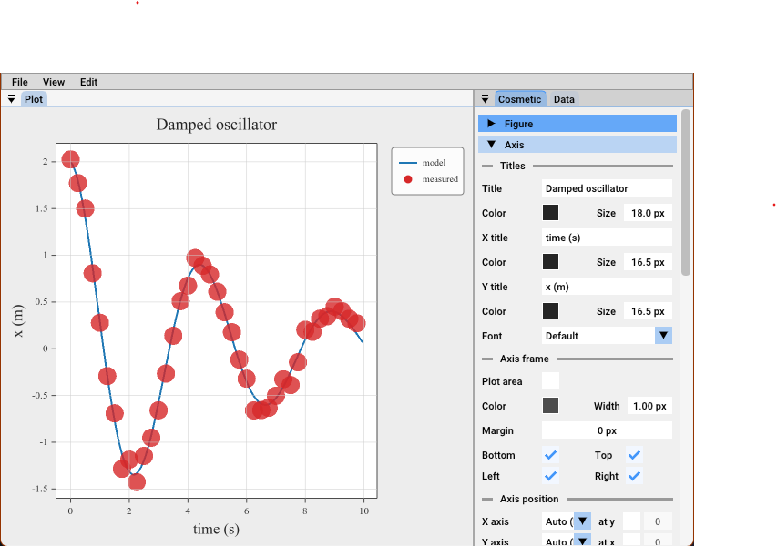

1. **Retitle it.** In the Cosmetic panel, open **Axis → Titles** and type into the
   title field. The plot follows every keystroke.

   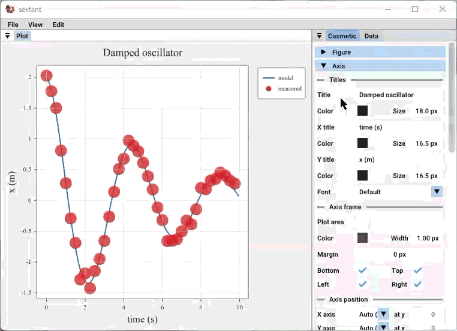

2. **Change a limit.** Under **Ticks → Limits**, tick off *Auto* for x and drag the
   high value, or click it and type one. Dragging the plot itself does the same
   (**Edit → Navigate**).

   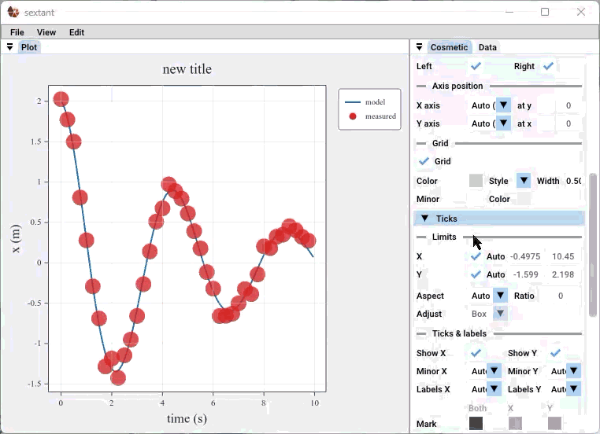

3. **Recolour a curve.** In the Data panel, open the tab of the curve (**model**).
   Click the colour swatch under **Appearance** and pick one.

   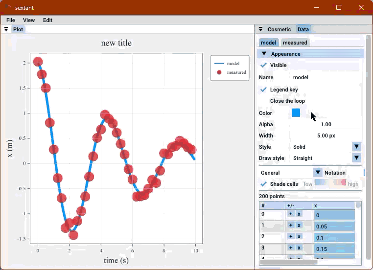

4. **Move a point.** Switch to the **measured** tab, click a *y* cell and type a
   new value. The point jumps to it.

   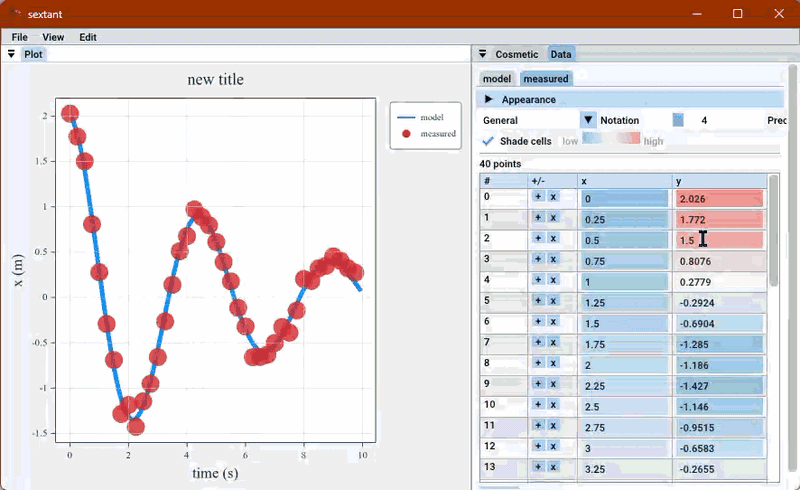

5. **Keep the result.** **File → Save** writes a PNG or SVG of exactly what you see.

   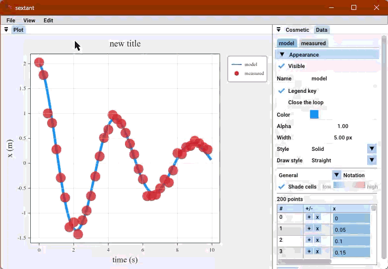


---

## How the window is laid out

| Part | What it edits |
|---|---|
| **Cosmetic panel** | The *axes*: titles, limits, ticks, grid, frame, legend, colorbar. The figure: suptitle, margins, gaps. In 3D: the camera and the box |
| **Data panel** | One tab per *plot object*: its appearance and its data as a table |
| **Plot** | The picture. Click a subplot to select it; navigate with the mouse |
| **Menu bar** | Save, resize, show or hide either panel, navigation, hints and the subplot selector |

**One rule decides where a control is: an object that has a tab in the Data panel
is edited in that tab and nowhere else.** The Cosmetic panel never lists your
lines, bars or surfaces; it holds what belongs to the axes around them.

**Both panels edit the selected subplot.** With more than one subplot, click one
(it gets an outline) or pick it in the menu bar's subplot selector. The selection
is not saved in the picture: the outline is never drawn into PNG or SVG.

**Twin axes** (`twinx`/`twiny`) are edited one layer at a time. A layer selector
(Host / Twin x / Twin y) appears beside the subplot selector when the cell has twins. A twin's panel hides what belongs to the cell (the title,
the frame, the legend) and greys out the axis it shares with its host.

Either panel can be hidden from **View**. The panels' state is not kept between
runs.

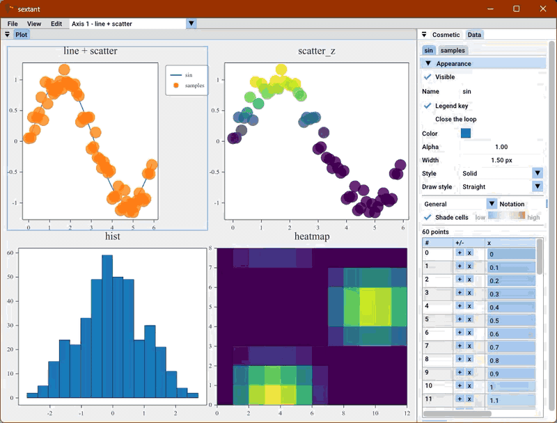

---

## Working with numbers

The numeric fields behave the same everywhere:

- **Click** a field and type; **Enter** or clicking away commits.
- **Drag** sideways to slide the value. The step follows the span on screen, so the
  same drag suits an axis over 1e-6 and one over 1e9.
- A **colour swatch** opens a picker when clicked.
- A value that differs from what it follows, such as a per-axis tick colour that
  overrides the shared one, is shown in full colour; the inherited one is dimmed.
  **Right-click** an overridden field and choose **Follow …** to clear it.
- Text fields hold the *source* string. Math written with `$…$` is shown as
  written and drawn as math; a half-typed expression is drawn as typed, with no
  warning.
- A field whose text is not valid yet (a tick format that is not one `%f`, `%e` or
  `%g`) turns red and sends nothing.

---

## Cosmetic panel

Four groups, each opened with its header. Groups share their names between 2D and
3D, so a selection that moves between the two finds things where it expects them.

| Group | Holds |
|---|---|
| **Figure** (closed by default) | **Suptitle**: text, font, colour, size, alignment, offset. **Layout**: background colour, margins, the gaps between subplots, and a readout of the plot frame and measured insets these settings give |
| **Axis** | **Titles**: title, x title, y title, with colour and size under each, and the axes font. **Axis frame**: plot-area colour, frame colour and width, margin, and which of the four spines to draw. **Axis position**: where each axis sits (low, mid, high, or pinned at a value) |
| **Ticks** | **Limits** (with *Auto*, aspect and adjust, and an **Axis** checkbox that turns the axis off as `set_axis_visible()`), **Ticks & labels**, **Scale & format**, and the x and y tick tables |
| **Legend & colorbar** (closed by default) | Legend: show, text, size, font, the twelve anchors, margin, offset, frame fill and border. Colorbar: text, size, font, border, anchor, bar width and margin |

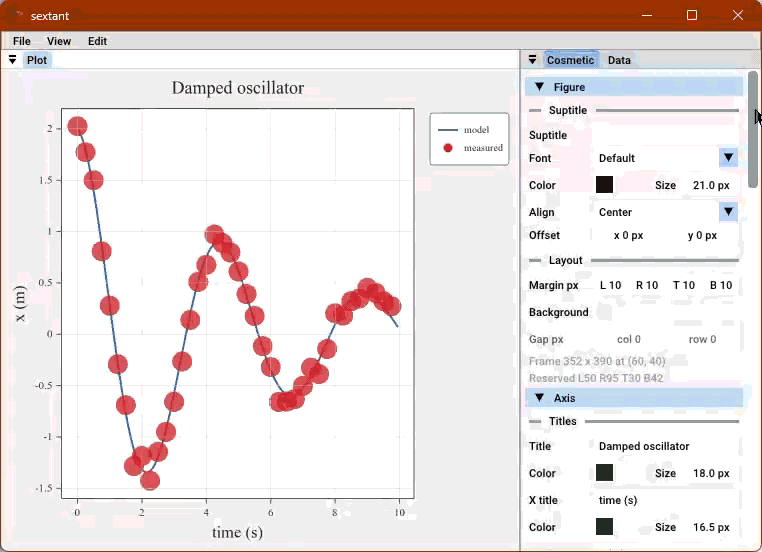

**Limits.** While an axis is on *Auto*, its two fields show the limits it
resolved to, and follow the data. Dragging a field turns *Auto* off for that axis
in the same edit. **Aspect** is *Auto*, *Equal* or *Ratio*; **Adjust** chooses
whether the box or the data limits give way.

**Ticks and labels.** Show or hide marks and labels per axis, turn minor ticks on
or off (*Auto* is on for log and symlog axes), and set the look in one table:

| | Both | X | Y |
|---|---|---|---|
| Mark colour, Length, Width, Minor | edits both axes | this axis only | this axis only |
| Label colour, Size | | | |

*Both* edits the shared value; an axis column overrides it for that axis only.

**Scale and format.** Per axis: *Linear*, *Log* or *Symlog*, with the base or the
linear threshold they need, and a **Format** such as `%.2f`. An empty format
restores the default. Every scale is open to every axes, heatmaps included.

**Shared axes.** When axes share an axis (`sharex`), a line under Limits names the
other members. Limits and scale edit the whole group.

**Tick tables.** Under each axis, the ticks can be automatic or set by hand,
position by position, with their labels.

**Polar cells.** A polar subplot's Cosmetic panel has the same groups, with θ and r
in place of x and y: where θ = 0 sits and its offset, the direction, the sector
(θ min and max), the r limits, r ticks and their format, where the r labels sit,
and the θ grid. The frame is one outline, so there are no spine boxes or axis
positions.

**Grid weights.** Drag the boundary between two subplots on the plot to resize
the columns or rows beside it; a double-click evens the two out. Nothing else in
the grid moves.

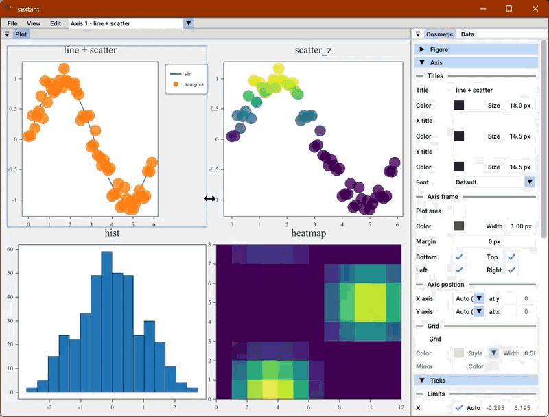

---

## Data panel

Each plot object in the selected subplot has a tab: every plotting call's object
(lines, markers, bars, heatmaps and images, contours, fills, arrows, reference lines
and bands, shapes, pies), and every text or annotation. In 3D, so does every object
and plane; in a polar cell, the θ and r columns stand in for x and y.

A tab has two parts:

**Appearance** (a collapsible header, open by default) carries every option the
plotting call takes, except per-point data: colour and alpha, width and line
style, marker and size and outline, bar width and edges, colormap with *Reversed*,
`vmin`/`vmax` and the **Norm** (with its *Centre* or bounds), a heatmap's origin and
contour levels, error-bar styling, the legend key and its name, and the colorbar.
A *Legend key* box with no name says so, since a key needs a name to be drawn.
Beside *Visible*, a **Z-order** field moves the object up or down the draw order.
A norm that stops fitting after an edit (a log norm whose range reaches 0) draws as
linear until it fits again.

**The table** holds the object's data.

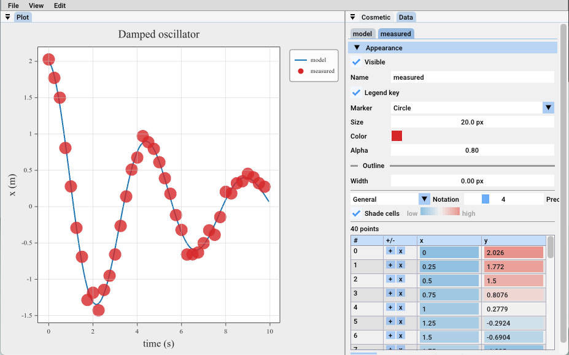

### Editing values

Click a cell and type. The point moves as you commit. A cell shows the number
rounded to the panel's format; clicking it reveals the full value, and committing
it unchanged does not round the data.

- **Number format** (inside each tab, under Appearance): *General*, *Fixed* or
  *Scientific*, with a precision of 0 to 17. One setting covers every cell.
- **Shade cells**: each cell is tinted by where its value falls in its column's
  range, so a trend reads at a glance and an outlier stands out. Turn it off for a
  plain table.

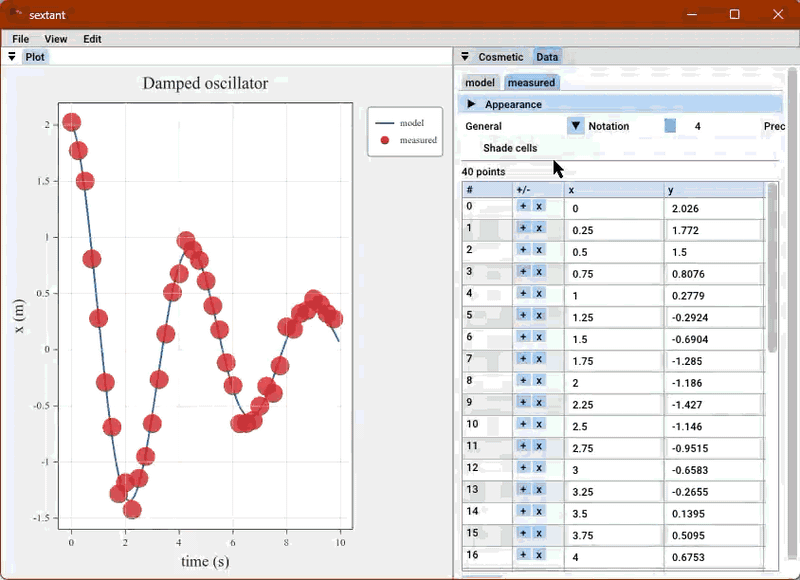

### Adding and removing points

A line, scatter, bar or `scatter_z` table has a gutter on the left that stays put
when the table scrolls sideways:

- **+** inserts a point after that row. It starts as a copy of the row above, so
  the shape does not jump until you edit it.
- **x** deletes that row.

A **+ point** button appends at the end, and a table deleted down to nothing can
be appended into again. Error bars and hover labels (`hint_labels`) move with
their points. An inserted point copies its neighbour's error bar.

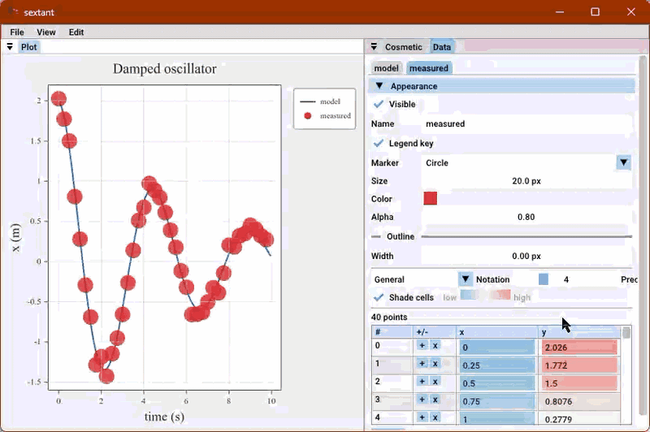

### Matrices

A heatmap's table is its grid, rows by columns. A frozen header row and column
carry `+` and `x` for whole columns and rows. An insert copies its predecessor
so the picture does not jump; a removal closes the gap. With one row or column
left, the `x` is greyed out and a tooltip explains.

A note above the grid says which end of the screen row 0 is drawn at, and, for a
heatmap with an extent, the extent and the cell size it implies.

A very wide matrix (more than about 500 columns) gets a **First column** spinner that
pages the visible window; the buttons keep acting on the true column index shown in
the header.

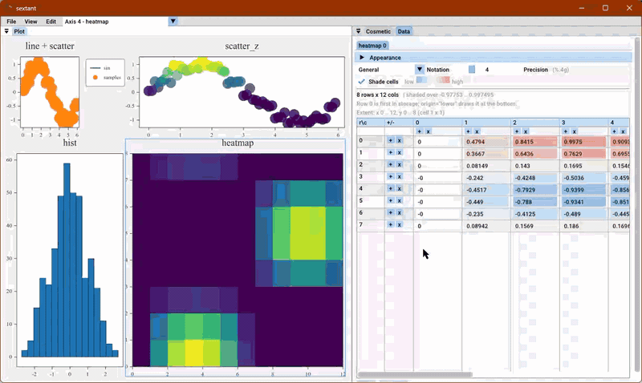

### Forms

Shapes, pies, sloped reference lines and contours carry their geometry as fields
under Appearance: a circle's centre and radius (each in data, frame fraction or
pixels), a wedge's angles and hole, a pie's start angle, direction, distances,
explode and labels, a sloped line's mode (point and slope, or two points), a
contour's levels or their count.

### Text and annotations

A text or annotation tab is a form, not a table: the string (multi-line), its
position (in data units or as a fraction of the frame), an optional arrow, and
sections for its appearance, box and arrow. *Math in $…$* switches math on or off
for that string.

---

## 3D cells

A 3D cell has its own Cosmetic panel: the same groups, plus a **View** group for
the scene.

| Group | Holds |
|---|---|
| **View** (open) | **Camera**: azimuth, elevation, zoom, a target readout and *Reset view*. **Box**: aspect per axis, frame margin, pane colours and visibility. **Grid** |
| **Figure** (closed) | As in 2D |
| **Axis** | Titles for x, y and z, the frame, and where each axis sits. There are no spine boxes: a box has no "top spine" |
| **Ticks** | Limits and tick tables for x, y and **z** |
| **Legend & colorbar** (closed) | As in 2D |

Orbit with the left mouse button (**Edit → Navigate**), zoom with the wheel,
fly with W, A, S, D, Q, E, and double-click to return to the default camera. All
of these act on the selected cell only.

In the Data panel a 3D cell's objects are tabs like any other. A `bar3d` grid
shows its heights as a matrix whose row and column headers are the u and v
values, editable in place, with a *heights / bases* switch when bars have
bases. A **plane** gets a tab of its own (`P0`, `P1`, …) just ahead of its
objects: visibility, facing, offset and alpha. Its 2D objects follow as
`P0 line 0` and so on, edited exactly as in a 2D cell. A mesh tab shows its
**Topology** (face count and the vertex indices of each face) read-only;
re-meshing is a data change, not an edit.

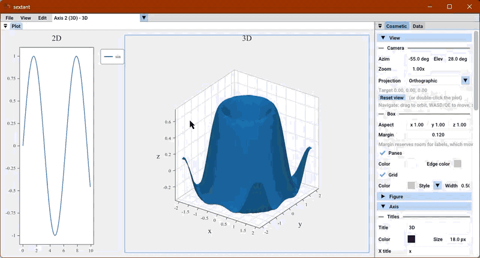

See [3d.md](3d.md) for what each 3D kind is.

---

## Edits and your program

Panel edits are not a scratch copy. They change the figure, and they behave
sensibly when your program keeps running.

- **They survive `refresh()`.** A program that updates data in a loop and calls
  `refresh()` does not wipe titles, colours, limits, ticks, the camera, the legend
  or the layout you edited.
- **Your calls win over older edits.** If the program calls `set_title()`,
  `set_xlim()`, `set_camera()` or another setter after you made an edit in the
  panel, the program's value is the one on screen. The rule is per field: setting
  the y limits does not touch an x limit you dragged.
- **Data edits follow the data they were made over.** If the program replaces an
  object's data (`set_*_data()`, or a fresh plotting call) after you started editing
  it, the edit is dropped rather than written into the new arrays.
- **You can read the result back.** `title()`, `xlim()`, `camera()` and the data
  getters report what the panel set. See [Reading back](api.md#reading-back).
- **`cla()` clears the panel's edits** along with everything else on the axes.
  To animate, use `set_*_data()`, which leaves the axes alone.
- **Saving writes what is on screen.** **File → Save** is always exact; a
  `savefig()` from your code sees the panel's edits once `refresh()` has folded
  them in.

```cpp
// Edit the live plot while the program animates it.
fig->show(false);
while (!fig->wait_closed(1.0 / 30)) {
    step(y);
    ax->set_line_data(0, x, y);   // data moves; your colours and titles stay
    fig->refresh();
}
```

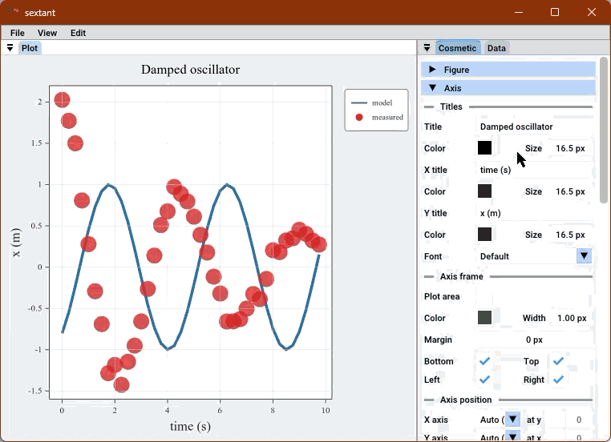

---

## Recipes

**Tune a figure, then export.** Plot with defaults, open the window, adjust titles,
fonts, margins and colours by eye, then **File → Save** as SVG. To hit an exact
size, use **File → Resize to plot frame**: it resizes the window so the *plot
area*, not the whole window, has the size you give.

**Fix an outlier by hand.** Hover the odd point to see which object and index it
is (**Edit → Hints**), open that object's tab in the Data panel, and retype the
cell. With *Shade cells* on, the outlier is already coloured differently.

**Arrange a subplot grid.** Drag the boundaries between subplots until the
proportions suit, set the margins and gaps in **Figure → Layout**, then save.
Read the weights back with `col_ratios()` and `row_ratios()` to put them in code.

**Share an axis.** After `sharex`, change the limits or the scale of any member;
the whole group follows.

**Tidy a heatmap.** In its tab, pick a colormap (and tick *Reversed* if needed),
set `vmin`/`vmax`, add contour levels, tick *Colorbar* and give it a name.

**Debugging a program.** Show the figure with `show(false)`, keep working, and
use the table to check a value against your expectation without a `printf`.

---

## Looks and sizes

The panels' look is set once, when the figure is created. They follow the
monitor's DPI.

```cpp
sextant::Figure::create({.theme = sextant::PanelTheme::Dark,   // or Light, Classic
                         .panel_width = 300.0f});
```

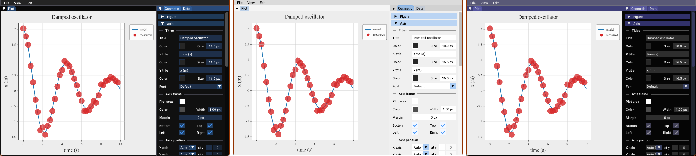

`theme` styles the panels, not the plot. `panel_width` is the initial width of the
side panels; drag the dock boundary to change it afterwards. The window grows by
the panels' width, so the plot area keeps the size you asked for.

---

## Known limits

- The panels exist only in the window: PNG and SVG output has no controls.
- A mesh's indices (`surface_tri`) are shown, not edited.
- The open or closed state of a group is not remembered between runs.
- Per-point error-bar values and `hint_labels` move with their points but are not
  columns in the table.
